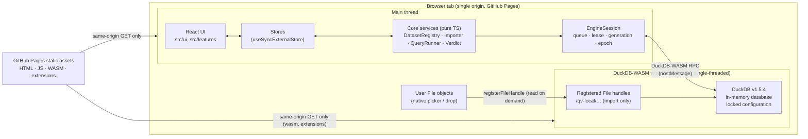
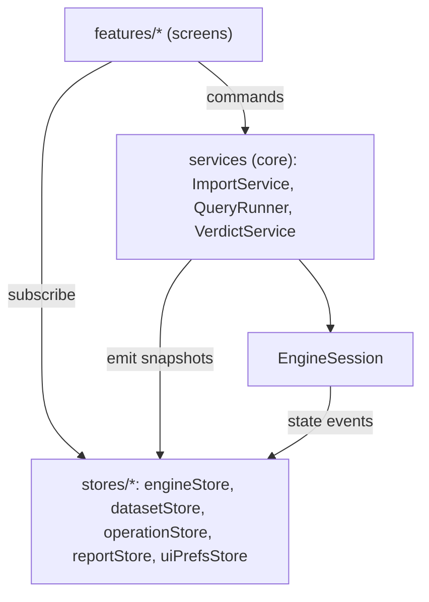

# QueryVerdict production architecture

> **Status · Proposed, 2026-11-27.** Drafted by Claude Code at the maintainer's request (D-010 assigns architecture to ChatGPT; this reassignment is recorded in [SPEC_AMENDMENTS.md](SPEC_AMENDMENTS.md) AM-017). Maintainer approval and an independent Codex review are required before production code depends on it. Every decision here is **provisional** (P-043 to P-056 in [DECISIONS.md](DECISIONS.md)) until approved. No production code exists. Nothing in this document is evidence that a design works: where a claim rests on spike evidence or official documentation, the source is cited; anything else is a proposal to be qualified.
>
> **Inputs:** [PRD](PRD.md) (merged in PR #4; its status line still reads "Proposed", see AM-001) · [UI specification](UI_SPECIFICATION.md) and [design system](DESIGN_SYSTEM.md) (merged in PR #5) · [SQL_ANALYSIS_FINDINGS.md](SQL_ANALYSIS_FINDINGS.md) (verified algorithms, defect register QV-SA-001 to QV-SA-005) · [FEASIBILITY.md](FEASIBILITY.md) (spike evidence, Chrome only) · spike source in `spikes/browser-feasibility/` (research code, not production).
>
> **Companion documents:** [IMPLEMENTATION_PLAN.md](IMPLEMENTATION_PLAN.md) (modules M01–M15 and task briefs) · [TESTING_STRATEGY.md](TESTING_STRATEGY.md) · [SPEC_AMENDMENTS.md](SPEC_AMENDMENTS.md) (contradictions and proposed PRD/UI amendments, not applied).

## Contents

1. Principles and constraints
2. System overview
3. Directory structure
4. Module boundaries
5. Dependencies and version qualification
6. Application and state architecture
7. Engine host: DuckDB-WASM initialisation and lockdown
8. Engine protocol and the operation model
9. Session lifecycle, lease, generation and data epoch
10. Datasets: ingestion, registration and the managed-table model
11. Query execution and bounded results
12. Cancellation, deadlines and recovery
13. SQL parsing and the Verdict boundary
14. Verdict analysis pipeline
15. Snapshot consistency
16. Report publication and invalidation
17. Profiling, results rendering and the Visual Verdict
18. Persistence and export
19. Security and network isolation
20. Deployment, browsers and licensing
21. Error handling and resource cleanup
22. Testing architecture
23. Engineering requirements traceability (QV-ENG-*)
24. External verification record
25. Open questions

## 1. Principles and constraints

**Non-negotiable** (PROJECT_VISION, AGENTS.md §5, D-001 to D-016): free and open source; static site on GitHub Pages; no backend, hosted database, paid API or mandatory LLM; no registration; user data never leaves the device; runtime requests only for the app's own same-origin static assets; zero mandatory recurring cost.

**Architectural principles:**

1. **Fail closed.** No SQL, file input or analysis until the engine's security controls are verified. An unknown, unsupported or unverifiable condition produces `unsupported`, `inconclusive` or a refusal, never a pass.
2. **One owner per resource.** The engine session owns the worker, the queue and the lease. Operations never hold the engine past their bound; the session can always revoke.
3. **Pure core, thin UI.** All engine, dataset, query and Verdict logic is framework-free TypeScript in `src/core/`, testable without React. The UI subscribes to it.
4. **Bounded everything.** Every wait, result, probe and boot has a finite bound and a defined terminal outcome.
5. **Exact values.** Counts and values cross from the engine as decimal text and become `BigInt` or strings; never a JavaScript `Number` on the counting path.
6. **Evidence is versioned.** Every result and report carries the engine generation, the data epoch and the query identity, and becomes historical when any of them changes.
7. **Reimplement, don't port.** The spike proved algorithms and failure modes. Production code is rewritten against this specification, test-first, reusing only the components listed in §5.4.
8. **No speculative features.** Only the P0 scope of the PRD is designed in detail. P1/P2 items are noted where they constrain a boundary.

## 2. System overview



- **Main thread:** React UI, stores, core services, and `EngineSession`, which controls the DuckDB worker through the DuckDB-WASM async API. Only bounded result batches are decoded on the main thread (spike evidence: 0 long tasks over 50 ms in headless Chrome for bounded results, rendering untested; FEASIBILITY §9.6, §10.6).
- **DuckDB worker:** runs all SQL, imports and Verdict probes. It is created by DuckDB-WASM, terminated by the session on unrecoverable cancellation, and replaced by a freshly verified worker (a new **generation**).
- **No other workers in P0.** A dedicated watchdog worker is not proposed; deadlines are enforced from the main thread (background-tab throttling is a documented limitation, §12.5).

## 3. Directory structure

The production application lives at the repository root. The spike stays in `spikes/` and is excluded from production builds, type-checking and tests.

```
/
├─ index.html                      # app entry (meta CSP injected at build)
├─ package.json / package-lock.json
├─ tsconfig.json                   # strict; src + tests
├─ vite.config.ts                  # production build, base path, CSP plugin
├─ vite.harness.config.ts          # test-only harness build (never deployed)
├─ vitest.config.ts
├─ playwright.config.ts
├─ eslint.config.js
├─ LICENSE                         # after the maintainer chooses a licence
├─ THIRD_PARTY_NOTICES.md          # generated + reviewed (M15; scaffold in M01)
├─ scripts/
│  ├─ vendor-extensions.mjs        # downloads + SHA-256 verifies DuckDB extensions at build time
│  ├─ extensions.lock.json         # committed hashes
│  ├─ check-artifact.mjs           # dist/ inspection: no harness markers, no external URLs, asset inventory
│  ├─ notices.mjs                  # third-party notice inventory (M01 scaffold, M15 complete)
│  └─ fixtures/                    # deterministic fixture + oracle generators (Python stdlib, pyarrow for Parquet)
├─ public/                         # git-ignored generated assets (vendored extensions)
├─ harness/                        # test-only entry: fault injection, negative controls
├─ src/
│  ├─ main.tsx                     # bootstrap
│  ├─ app/                         # App shell, view selection, providers, error boundary
│  ├─ core/                        # framework-free TypeScript (no React imports; lint-enforced)
│  │  ├─ engine/                   # EngineSession, lockdown, bundles, protocol, statements, epoch
│  │  ├─ results/                  # bounded collection, exact formatting
│  │  ├─ datasets/                 # DatasetRegistry, Importer, naming, admission
│  │  ├─ verdict/                  # parser adapter, recogniser, planner, probes, validator, finaliser
│  │  ├─ operations/               # operation records, ids, staleness keys
│  │  ├─ profile/                  # ReleaseProfile: every finite limit, fixed at boot
│  │  └─ util/                     # lossless JSON, bigint, deadlines, errors, identifiers
│  ├─ stores/                      # external stores bridging core → React
│  ├─ ui/                          # design tokens, primitives (Button, Tabs, Splitter, Badge, Table, Dialog, Status)
│  ├─ features/                    # landing, workspace, explorer, editor, results, verdict, settings
│  ├─ demo/                        # synthetic demo dataset (generated, small, committed under fixtures rules)
│  └─ styles/                      # tokens.css, base.css
├─ tests/
│  ├─ unit/                        # Vitest: core logic, pure functions, stand-in engines
│  ├─ e2e/                         # Playwright against dist/ (production) and dist-harness/
│  ├─ fixtures/                    # small synthetic fixtures (git-allowed per .gitignore)
│  └─ oracle/                      # independent Python brute-force oracle + its tests
├─ docs/
└─ spikes/                         # research code, excluded
```

**Rule:** `src/core/**` must not import from `src/ui`, `src/features`, `src/stores` or React (enforced by an ESLint import boundary rule in M01).

## 4. Module boundaries

| Layer / package | Responsibility | Depends on | Must not |
|---|---|---|---|
| `core/profile` | `ReleaseProfile`: all limits, deadlines, memory setting, admission caps; immutable after boot | – | read browser state |
| `core/util` | lossless JSON, BigInt parsing, identifier quoting/parsing, deadline helpers, typed errors | – | perform I/O |
| `core/engine` | worker lifecycle, lockdown + verification, queue, lease, cancellation, recovery, generation, data epoch, statement classification | profile, util, `@duckdb/duckdb-wasm` | know about datasets or Verdict |
| `core/results` | bounded Arrow collection, truncation accounting, exact cell formatting | engine (types), util, `apache-arrow` (via DuckDB-WASM) | render |
| `core/datasets` | registry (catalog-reconciled inventory), importer, naming, admission, re-import | engine, results, profile | run user SQL |
| `core/operations` | operation identity, staleness keys (generation, epoch, query hash, input identity) | util | – |
| `core/verdict` | parser adapter, MVP recogniser, resource qualifier + single budget gate, probes, validators, report finaliser, expectations | engine, results, operations, profile, util | touch UI state; run outside a lease |
| `stores/*` | expose core state to React via `useSyncExternalStore`; no business logic | core | mutate core state directly |
| `ui/*` | stateless, accessible primitives and tokens | – | import core |
| `features/*` | screens composed from ui + stores; dispatch commands to core services | stores, ui, core (commands only) | call DuckDB directly |
| `harness/` | test-only entry, fault injection | core | ship in `dist/` |

## 5. Dependencies and version qualification

### 5.1 Runtime dependencies (proposed; exact pins)

| Package | Version | Purpose | Status | Licence (to confirm in M15 inventory) |
|---|---|---|---|---|
| `@duckdb/duckdb-wasm` | **1.33.1-dev57.0** (DuckDB v1.5.4) | SQL engine | **Provisional (P-016).** Development-numbered build; spike-qualified in Chrome only. M02 includes the engine-semantics qualification suite; switching versions requires that suite to pass (§24) | MIT per repository; npm package lacks the LICENSE file (FEASIBILITY §10.12) |
| `apache-arrow` | as required by DuckDB-WASM (17.x in the spike) | result decoding (transitive) | Provisional | Apache-2.0; NOTICE must ship |
| `react`, `react-dom` | 19.3.1 | UI | Provisional (P-001); spike-built | MIT |
| SQL editor | **decided in M05 by experiment E9**: CodeMirror 6 (leading candidate) or Monaco | editing, highlighting | Unqualified (P-005) | see §24 |
| `@tanstack/react-virtual` | only if M06's rendering measurement fails the 200 ms target | result grid windowing | Unqualified (P-007, conditional) | see §24 |
| DuckDB extensions `parquet`, `json` (wasm_eh, wasm_mvp) | v1.5.4, hashes in `extensions.lock.json` | Parquet import; **`json` is required by Verdict** (`json_serialize_sql`) even though JSON files are out of P0 | Provisional (P-018) | notices unresolved (FEASIBILITY §10.12) |

**Not used in P0:** React Flow (P-006: the Visual Verdict is a fixed HTML/SVG layout; no graph canvas, AM-012); a state-management library (stores are ~100 lines of TS); a router library (§6.3); TanStack Table (headless table logic is unnecessary for a bounded, read-only grid; revisit only with sorting/filtering in P1); IndexedDB/OPFS (no persistence in P0, §18); web fonts until cleared (system font stack first, DESIGN_SYSTEM §4).

### 5.2 Development dependencies (proposed)

`typescript` 7.0.2 (strict), `vite` 8.3.8, `@vitejs/plugin-react` 6.3.0, `vitest` 5.1.1, `@playwright/test` 1.65.1, `eslint` + `typescript-eslint` + an import-boundary rule, `axe-core` via `@axe-core/playwright` for automated accessibility checks. Versions marked as spike-proven are the ones the spike built with (FEASIBILITY §9); ESLint and axe versions are chosen and pinned in M01 and recorded in DECISIONS. Package manager: **npm** with a committed `package-lock.json` (the spike's toolchain; P-044).

### 5.3 Version qualification rule

A dependency is **qualified** only when: exact version pinned; licence read from the shipped package or source; bundle cost measured in the production build; its tests pass on the browser matrix; and, for the engine, the engine-semantics suite (TESTING_STRATEGY §5.3) passes. Upgrades follow the same rule and are one change per branch.

### 5.4 Reuse from the spike

Independently validated by Codex (Step 4.4.4) or Step 3.6 review, **reimplemented with tests, not copied wholesale**:

| Spike source | Production use | Evidence |
|---|---|---|
| `src/analysis/stats.ts` (derivation, invariants, join-expectation evaluation) | `core/verdict/stats.ts` | 72 independent DuckDB comparisons; oracle sweep |
| `src/engine/lockdown.ts` (statements, required settings, verification, escalation probes) | `core/engine/lockdown.ts` | Step 3.6 review; selected security tests; no external requests in Codex's Chrome matrix |
| `src/engine/bounded.ts`, `format.ts` (bounded collection, exact formatting incl. DECIMAL words) | `core/results/` | Step 3.6 review (P-020); implementer tests |
| `src/analysis/json.ts` (lossless JSON) | `core/util/lossless-json.ts` | implementer tests + H1 regression |
| `scripts/make_analysis_fixtures.py`, `tests/fixtures/analysis/cases.json` | `scripts/fixtures/`, `tests/oracle/` | implementer; Codex re-ran Python tests |
| `scripts/vendor-extensions.mjs`, `extensions.lock.json` | `scripts/` | spike builds |
| `recognizeMvp` field allowlist concept, `parseColumnRef` | `core/verdict/recognise.ts`, `core/util/identifiers.ts` | implementer tests |

**Redesigned, not ported:** `session.ts` (lease lifetime, recovery bounds, publication fence: QV-SA-002/003/005), `analyze.ts` (monolith; mixed scopes and test hooks), `executor.ts` (rebuilt around the revocable lease).

## 6. Application and state architecture

### 6.1 Layers



### 6.2 Stores

Each store is a small class exposing `getSnapshot()` / `subscribe()` for `useSyncExternalStore`. Snapshots are immutable objects; updates replace the snapshot.

| Store | Holds | Written by |
|---|---|---|
| `engineStore` | session state, generation, data epoch, boot info, lockdown verification summary, last failure | EngineSession |
| `datasetStore` | inventory entries (§10.4) | DatasetRegistry |
| `operationStore` | queued/active/terminal operations with kind, identity, timings (local clock only) | EngineSession, services |
| `reportStore` | the current Verdict report + its staleness evaluation; the current result set | QueryRunner, VerdictService |
| `uiPrefsStore` | theme, density, layout sizes; **session-only** (§18) | settings UI |

React StrictMode double-mounting must not create two engines: the session is created once per page in `app/bootstrap.ts` outside React, and React components only subscribe (lesson from the spike's StrictMode defect, PROGRESS 2026-11-25).

### 6.3 Views and routing

One static entry (`index.html`). Views (`landing`, `workspace`, `verdict-detail`) are held in `uiPrefsStore`; the URL hash may carry only a public view identifier (`#/workspace`), never datasets, SQL, expectations or results (UI_SPECIFICATION §1). Refresh starts a new session. No router dependency.

## 7. Engine host: DuckDB-WASM initialisation and lockdown

Startup is fail-closed and identical for first boot and recovery:

```mermaid
sequenceDiagram
  participant S as EngineSession
  participant W as DuckDB worker
  S->>S: select bundle (eh, else mvp) from same-origin URLs
  S->>W: new Worker(bundle.mainWorker); instantiate(module)
  S->>W: open(':memory:', castBigIntToDouble=false)
  S->>W: connect()
  S->>W: SET threads=1; SET memory_limit=<profile>; other profile settings
  S->>W: lockdown statements (repositories, autoload/autoinstall off, INSTALL+LOAD parquet,json, allowed_directories, enable_external_access=false, lock_configuration=true)
  S->>W: verify effective settings, loaded extension set, lock rejects SET
  alt all verified within bootTimeoutMs
    S->>S: generation += 1; state = ready
  else any failure or timeout
    S->>W: terminate()
    S->>S: state = failed (no SQL, no import, no Verdict)
  end
```

- **Settings are fixed at boot** because `lock_configuration = true` rejects later `SET` (spike-verified). Every value comes from `ReleaseProfile`; changing a limit requires a new engine.
- `castBigIntToDouble: false` keeps 64/128-bit integers exact through Arrow (spike-verified).
- Extensions are served from the app origin (`public/duckdb-ext/v1.5.4/...`), downloaded at build time and SHA-256 verified (P-018). Runtime extension acquisition from third parties is disabled and verified.
- **Boot timeout** (`bootTimeoutMs`, default 30 s) covers every step; on timeout the candidate worker is terminated.

## 8. Engine protocol and the operation model

DuckDB-WASM already provides the worker RPC (`AsyncDuckDB` / `AsyncDuckDBConnection`). QueryVerdict does **not** add a second worker protocol; it adds a typed **operation layer** on the main thread.

```ts
// core/engine/types.ts (proposed contract)
export type Generation = number & { readonly __brand: 'Generation' };
export type DataEpoch = number & { readonly __brand: 'DataEpoch' };
export type OperationId = string & { readonly __brand: 'OperationId' };

export type OperationKind = 'query' | 'import' | 'remove' | 'reimport' | 'verdict' | 'catalog';

export type SessionState =
  | { kind: 'idle' } | { kind: 'starting' } | { kind: 'ready' }
  | { kind: 'busy'; op: OperationId } | { kind: 'cancelling'; op: OperationId }
  | { kind: 'recovering'; reason: string } | { kind: 'failed'; reason: string }
  | { kind: 'disposed' };

export type Terminal =
  | { status: 'ok' }
  | { status: 'error'; message: string; phase: 'parse' | 'bind' | 'execute' | 'engine' }
  | { status: 'cancelled'; by: 'user' | 'deadline'; stop: 'cooperative' | 'terminated' }
  | { status: 'stale'; reason: 'generation-changed' | 'disposed' }
  | { status: 'refused'; reason: string };

export interface OperationHandle<T> {
  readonly id: OperationId;
  readonly kind: OperationKind;
  readonly generation: Generation | null;     // assigned when the operation starts
  readonly result: Promise<{ terminal: Terminal; value?: T }>; // always settles within its bound
  cancel(): void;                              // works while queued or active
}

export interface EngineSession {
  readonly state: SessionState;
  readonly generation: Generation | null;
  readonly epoch: DataEpoch;
  start(): Promise<void>;                      // fail-closed; rejects with the reason
  /** Queue a leased operation. The session owns the lease and can revoke it. */
  submit<T>(kind: OperationKind, body: (lease: Lease) => Promise<T>, bounds: OperationBounds): OperationHandle<T>;
  restart(reason: string): Promise<void>;
  dispose(): void;                             // terminal; every pending handle settles 'stale'
  subscribe(listener: (e: SessionEvent) => void): () => void;
}

export interface OperationBounds {
  queueWaitMs: number;      // time allowed before the operation starts
  runMs: number;            // deadline once started
  cancelGraceMs: number;    // cooperative cancel, then terminate
  cleanupMs: number;        // per cleanup statement
}

/** Capability passed to an operation body; invalid after revocation. */
export interface Lease {
  readonly id: OperationId;
  readonly generation: Generation;
  readonly signal: AbortSignal;                // aborted on cancel, deadline, revocation, dispose
  /** One statement, bounded result; rejects with LeaseRevokedError after revocation. */
  query(sql: string, shape: QueryShape): Promise<BoundedRows>;
  /** Streamed statement for user SQL (bounded collection, §11). */
  stream(sql: string, limits: ResultLimits): Promise<BoundedResult>;
  /** Cleanup statements still run after cancel, never after revocation or generation change. */
  cleanup(sql: string): Promise<'ok' | 'failed' | 'skipped'>;
  registerFile(name: string, file: File): Promise<void>;
  dropFile(name: string): Promise<void>;
}
```

**Rules:**

1. Every engine interaction goes through `submit`. The DuckDB connection is private to `EngineSession`.
2. One operation runs at a time (single-threaded engine, one connection). Queued operations can be cancelled and removed **before they start** (UI_SPECIFICATION §6; the spike lacked this).
3. The **lease is revocable by the session**: on deadline, cancel, dispose or recovery the session marks the lease revoked, aborts its signal, and **releases the queue slot itself** without waiting for the body's promise. Calls through a revoked lease reject immediately and never reach the engine. This is the structural correction for QV-SA-005.
4. A body that ignores its signal cannot keep the queue: after `runMs + 2 × cancelGraceMs` the session revokes, terminates the worker if a statement is still running, and starts recovery.

## 9. Session lifecycle, lease, generation and data epoch

```mermaid
stateDiagram-v2
  [*] --> idle
  idle --> starting: start()
  starting --> ready: verified (generation+1)
  starting --> failed: any control fails / boot timeout
  ready --> busy: operation starts (lease granted)
  busy --> ready: operation settles; lease released
  busy --> cancelling: cancel / deadline
  cancelling --> ready: cooperative stop within cancelGraceMs
  cancelling --> recovering: rejected / timed out / not stopped → terminate worker, revoke lease
  busy --> recovering: revoke (outer bound) → terminate worker
  recovering --> ready: new worker verified (generation+1)
  recovering --> failed: boot fails / recovery timeout
  failed --> starting: user retry (start())
  idle --> disposed: dispose()
  ready --> disposed: dispose()
  busy --> disposed: dispose()
  recovering --> disposed: dispose()
  failed --> disposed: dispose()
```



- **Generation** increments on every verified boot. Anything tagged with an older generation is stale.
- **Data epoch** increments whenever data visible to Verdict may have changed: a completed or failed import, removal or re-import; any user statement not classified as a single read-only SELECT (§11.2); recovery (all tables lost). Reports carry the epoch they were computed at (§16).
- **Recovery in P0 has nothing to reattach.** P0 uses managed tables only, and file handles are unregistered after import (§10.3). Recovery therefore = terminate, boot, verify, mark every managed dataset `needs-reimport`, increment epoch. This removes the stalled-reattachment path of QV-SA-003 by design; recovery remains bounded by `bootTimeoutMs` and a `recoveryTimeoutMs` (default 45 s) after which the session is `failed`.
- **Disposal** settles every pending and queued handle as `stale` synchronously and terminates any worker, including a candidate mid-boot (spike-proven pattern).

## 10. Datasets: ingestion, registration and the managed-table model

### 10.1 Why managed tables only in P0

P0 imports CSV and Parquet into DuckDB-managed tables (PRD QV-DATA-001, P-040), because Verdict requires stable relations (P-038): views re-read files on every scan and cannot support snapshot-consistent evidence. Consequences (SQL_ANALYSIS_FINDINGS §6.1):

- **Memory:** the decoded table lives in the WASM heap; capacity is bounded by `memory_limit` and the WASM address space, not by file size. The release profile must state admission caps measured as import + analysis (P-041).
- **Recovery:** worker termination loses every table; datasets become `needs-reimport`.
- File-backed views remain a P1 candidate for ordinary SQL only (QV-ROAD-002). P-019 (file-backed views as the default) is superseded for P0 (AM-018).

### 10.2 Import pipeline

```mermaid
sequenceDiagram
  participant UI
  participant I as Importer
  participant S as EngineSession (lease)
  UI->>I: import(files, names)
  I->>I: admission: extension, byte size vs profile caps, combined cap
  I->>S: submit('import', bounds)
  S->>I: lease
  I->>S: registerFile('/qv-local/<uuid>.<ext>', File)
  I->>S: BEGIN TRANSACTION (fails if a user transaction is open → refused)
  I->>S: stream CREATE TABLE "<name>" AS SELECT * FROM read_csv(...) / read_parquet(...)
  I->>S: COMMIT
  I->>S: dropFile(...)  (unregister: the file is no longer readable by SQL)
  I->>I: registry.reconcile(); epoch += 1
  Note over I,S: on failure/cancel: ROLLBACK (bounded), dropFile, no partial table
```

- **CSV options (proposed, to be verified in M03 against v1.5.4):** explicit `header = true` detection as DuckDB's sniffer decides, UTF-8, and **`allow_quoted_nulls = false`** so `""` stays an empty string while an empty unquoted field is NULL. The spike observed that DuckDB's default turned `""` into NULL (PRD conflict, AM-002). The exact options are fixed in M03 after a probe and recorded in DECISIONS.
- **Transactions:** imports and removals run in their own explicit transaction. If a user transaction is open, `BEGIN` fails and the import is refused with "A transaction is open; COMMIT or ROLLBACK first" (spike-verified behaviour of nested `BEGIN`).
- **Naming:** normalised identifier from the filename, collision-resolved against the catalog *and* pending names inside the queue (spike `relationName` logic); the user can rename before import; the resolved name is shown before import.
- **Cancellation:** the `CREATE TABLE AS` statement is streamed so it can be cancelled cooperatively; otherwise the worker is terminated (spike: cooperative import cancel in 155 ms).
- **No partial tables:** the transaction guarantees all-or-nothing on the surviving engine.

### 10.3 File handles

After a successful import the virtual file is unregistered (`dropFile`) so user SQL cannot read raw files by path (the spike probe showed it could) and recovery has nothing to reattach. The `File` object is kept in memory (not in the engine) only to offer **Re-import**; if reading it later fails (browser access lapsed), the UI asks the user to choose the file again (PRD QV-DATA-002).

### 10.4 Inventory reconciliation

User SQL can create, drop, rename or replace tables. The inventory is therefore **derived from the catalog**, not maintained by hand:

```ts
// core/datasets/types.ts (proposed)
export type DatasetOrigin = 'imported' | 'sql' | 'demo';
export type DatasetState =
  | 'importing' | 'ready' | 'needs-reimport' | 'missing'   // missing: dropped or renamed by SQL
  | 'changed'                                               // same name, different table identity (oid)
  | 'failed';

export interface DatasetEntry {
  readonly relation: string;          // catalog name (quoted for SQL via identifiers.quote)
  readonly origin: DatasetOrigin;
  readonly state: DatasetState;
  readonly source?: { fileName: string; bytes: number; format: 'csv' | 'parquet' };
  readonly identity?: { database: string; schema: string; oid: string }; // from duckdb_tables()
  readonly rowCount?: string;         // exact text, only when measured
  readonly columns?: readonly { name: string; type: string; nullable: boolean | null }[];
  readonly verdictEligible: boolean;  // base/temp table, current schema, unambiguous, no generated columns
  readonly eligibilityReason?: string;
}
```

`reconcile()` runs a bounded catalog query after every epoch change and after recovery. Tables created by SQL appear with origin `sql`; imported tables that vanished become `missing`. (The UI specification has no state for these; AM-007.)

## 11. Query execution and bounded results

### 11.1 Execution

`QueryRunner.run(sql)` submits a `query` operation. The statement is streamed and collected with bounds applied **before display conversion** (P-020 defaults: 1,000 rows, 200 columns, 500 chars per cell, 2,000,000 display chars, 16 MiB Arrow bytes). Each truncation cause is reported separately. Engine limitation: DuckDB-WASM transfers whole Arrow batches (up to 2,048 rows), so one batch is allocated before checks run (FEASIBILITY §10.2); this is documented, not hidden.

```ts
export interface ResultLimits { maxRows: number; maxColumns: number; maxCellChars: number; maxDisplayChars: number; maxArrowBytes: number }
export interface BoundedResult {
  readonly columns: readonly { name: string; type: string }[];
  readonly rows: readonly (readonly CellText[])[];   // exact text; NULL and '' distinguished
  readonly truncation: { rows: boolean; columns: boolean; cells: number; display: boolean; bytes: boolean };
  readonly affectedRows?: string;                    // only when the engine reports it
}
export type CellText = { kind: 'null' } | { kind: 'text'; value: string; clipped: boolean };
```

### 11.2 Statement policy (proposal; AM-004, AM-005)

- **Classification:** before running, the text is passed to `json_serialize_sql` (json extension). A successful serialisation with exactly one statement is a **read-only SELECT**: the epoch does not change. Anything else (DML, DDL, `COPY`, transaction control, `ATTACH`/`USE`, multiple statements, parse failure) is treated as **possibly mutating**: the epoch increments after the operation settles, whatever its outcome. Spike-verified: `json_serialize_sql` rejects non-SELECT statements ("Only SELECT statements can be serialized"). Note that a SELECT can still advance a sequence with `nextval()`; that changes no table, so Verdict evidence is unaffected.
- **Multiple statements:** DuckDB-WASM ran every statement and returned only the last result (spike probe). P0 proposal: **refuse multi-statement input in Run SQL** with a clear message, detected by attempting `connection.prepare()` (which is expected to reject multiple statements; **to verify in M02**), falling back to running it and labelling the result "result of the last statement" if prepare-based detection is not reliable. Decision recorded in M06.
- **Transaction control:** allowed in Run SQL (ordinary DuckDB semantics). The app does not try to track the user's transaction state precisely. Instead, every app-initiated operation that needs its own transaction (import, removal, Verdict) issues `BEGIN` first and **fails closed** if that fails ("A transaction is open in this session; COMMIT or ROLLBACK first"), which is spike-verified behaviour of nested `BEGIN`. As a UX hint only, the status strip shows "Transaction may be open" after a user statement that the classifier recognises as `BEGIN`/`START TRANSACTION`, until `COMMIT`, `ROLLBACK`, `ABORT` or recovery.
- **Policy enforcement:** the locked configuration blocks remote access, extension installs and settings changes regardless of the statement (P-017); the classifier is a UX and invalidation tool, not a security boundary.

## 12. Cancellation, deadlines and recovery

### 12.1 Bounds (defaults; values live in `ReleaseProfile`, to be approved with P-036)

| Bound | Default | On expiry |
|---|---|---|
| Queue wait (Verdict, import) | 30 s | operation settles `refused` (queue-wait), never starts |
| Run SQL deadline | none by default (user cancels) | — (P0 proposal; long ordinary queries are the user's choice; a configurable cap is AM-009 open) |
| Import deadline | 120 s | cancel → grace → terminate |
| Verdict deadline | 30 s (including queue wait) | cancel → grace → terminate; report `budget-exhausted` |
| Cancel grace (request, then settle) | 2 s + 2 s | terminate worker, revoke lease, recover |
| Cleanup statement | 5 s | invalidate (terminate + recover) |
| Boot / recovery | 30 s / 45 s | `failed` |

### 12.2 Cancel flow

```mermaid
sequenceDiagram
  participant U as User / deadline
  participant S as EngineSession
  participant W as Worker
  U->>S: handle.cancel()
  alt operation queued
    S->>S: remove from queue; settle 'cancelled' (no engine work)
  else operation active
    S->>S: revoke lease (signal aborted; queue slot released by S)
    S->>W: cancelSent() (cooperative)
    alt stopped within grace
      S->>S: settle 'cancelled' (cooperative); state ready
    else rejected / hung / not stopped
      S->>W: terminate()
      S->>S: settle 'cancelled' (terminated); start recovery (bounded)
    end
  end
```

### 12.3 Late results

Results arriving after a handle settled are discarded: the handle is single-settlement, the lease is revoked, and any value is checked against `(operationId, generation)` before it reaches a store (spike lesson: stale rejection from a disposed session locked the UI).

### 12.4 Recovery outcome for data

After a terminate-and-recover, every managed table is gone: imported datasets become `needs-reimport`, SQL-created tables `missing`, the demo can be reloaded; every report and result becomes historical (generation changed). The editor text is untouched.

### 12.5 Background tabs

Deadlines use main-thread timers. Browsers throttle timers in hidden tabs (see §24 for what was verified), so a deadline may fire late in the background. P0 contract: bounds are guaranteed **in the foreground only**; on `visibilitychange` to visible, the session reconciles overdue operations immediately. This matches the PRD's "foreground acceptance, background observations".

## 13. SQL parsing and the Verdict boundary

- **Parser:** DuckDB's own (`json_serialize_sql`) through a **versioned parser adapter** (`core/verdict/parser-adapter.ts`) with lossless JSON. The adapter declares the DuckDB version it was qualified against; on a different engine version it refuses (`unsupported: parser not qualified for this engine`).
- **Recogniser:** a strict field allowlist (spike `recognizeMvp`, rewritten): exactly one SELECT; plain column refs or `*` without modifiers; one `JOIN` node of type INNER or LEFT, `REGULAR` reference; both sides `BASE_TABLE` without schema/catalog qualifiers, samples, time travel or column aliases; condition = AND of `COLUMN_REF = COLUMN_REF`, or `USING`; no WHERE, GROUP BY, HAVING, QUALIFY, modifiers, CTEs, subqueries. Unknown fields → `unsupported`.
- **Binding checks (in the lease):** `DESCRIBE` of the query (bind only, never executed); each relation resolved through `duckdb_tables()`/`duckdb_views()` across all attached databases to exactly one base or temporary table in the current schema without generated columns (P-038); keys same-type integers (`TINYINT` … `UHUGEINT`); at most 8 key columns.
- **P0 boundary (PRD QV-VER-001, P-031):** everything else is `unsupported` with the construct named. The experimental spike scope (chains, RIGHT/FULL, CTEs, WHERE probes, grain, metric) is **not** carried into production.

## 14. Verdict analysis pipeline

```mermaid
flowchart LR
  A["Analyze(sql, expectations)"] --> V["validate expectations<br/>(shape, invalid → unchecked)"]
  V --> L["submit('verdict') → lease<br/>queue wait counts against deadline"]
  L --> T["BEGIN (refuse if user txn open)"]
  T --> P["parse (adapter) → recognise → bind → classify relations"]
  P --> Q["resource qualification<br/>rows, key widths, grouping estimate"]
  Q --> B["Budget plan (single gate):<br/>every pair-producing probe priced from frequencies"]
  B --> F["frequencies → stats → invariants → SEMI JOIN → executed count → witnesses → witness verification"]
  F --> S["end fingerprints + table identities"]
  S --> R["ROLLBACK (bounded)"]
  R --> X["finalise report<br/>(publication fence)"]
  X --> O["reportStore (generation, epoch, query hash)"]
```



### 14.1 Single budget gate (QV-SA-001 correction)

`core/verdict/budget.ts` owns **all** work accounting. A probe may run only if the gate approves it:

```ts
export interface ProbeCost { readonly scansOfInputs: number; readonly pairRows: bigint; readonly groupingBytes: bigint }
export interface BudgetGate {
  /** Approve or refuse a probe; approved costs are added to the cumulative total. */
  approve(probe: ProbeName, cost: ProbeCost): { ok: true } | { ok: false; reason: string };
  readonly spent: ProbeCost;
  readonly limits: { executionPairRows: bigint; groupingBytes: bigint; maxInputRows: bigint };
}
```

- Pair-producing probes are the executed join count and every **witness recount through the join** (fan-out witness: L(k)·R(k); preserved unmatched witness: L(k) or R(k)). Their costs are known from the frequency tables **before** they run; cumulative cost must stay within `executionPairRows`.
- If the gate refuses witness verification, witnesses are reported `not-run` with the reason and **the report is not authoritative**. The spike's 3×4 join with a budget of 1 therefore runs zero pair-producing probes (acceptance T-ENG-001).
- Grouping is qualified from input rows × (key bytes + 16 + 64 assumed overhead) before any grouping runs; no `DISTINCT … LIMIT` pre-check (spike lesson H-B).

### 14.2 Validation chain

Unchanged from the verified spike algorithms (SQL_ANALYSIS_FINDINGS §3): key-frequency statistics in exact `HUGEINT`; mathematical invariants; `SEMI JOIN` recount with the query's own join node; executed `count(*)` within budget; witness identity; start/end key-multiset fingerprints and table OIDs. Any disagreement → the join is `inconclusive`; dependent findings and expectations are withdrawn.

### 14.3 Report model

```ts
export type FindingCategory = 'observed' | 'suspicious' | 'expectation-violation' | 'expectation-unchecked'
  | 'unsupported' | 'inconclusive' | 'diagnostic-failure' | 'query-failure';           // P-026
export type DisplayLabel = 'Observation' | 'Suspicious pattern' | 'Expectation violation'
  | 'Unsupported' | 'Inconclusive' | 'Unchecked' | 'Diagnostic failure' | 'Query failure';  // PRD §4 labels
export interface VerdictReport {
  readonly id: string;
  readonly identity: { queryHash: string; sqlText: string; inputs: readonly DatasetIdentity[] };
  readonly stamp: { generation: Generation; epoch: DataEpoch; finalisedAt: number };
  readonly authoritative: boolean;
  readonly nonAuthoritativeReasons: readonly string[];
  readonly status: 'analyzed' | 'partially-analyzed' | 'inconclusive' | 'unsupported' | 'query-failed'
    | 'diagnostic-failed' | 'budget-exhausted' | 'cancelled' | 'stale';
  readonly join: JoinEvidence | null;           // stats as exact decimal strings; witnesses ≤ 5 per kind
  readonly findings: readonly Finding[];
  readonly expectations: readonly ExpectationOutcome[];   // exactly one per declared expectation, in order
  readonly coverage: { checked: readonly string[]; notChecked: readonly string[] };
  readonly resources: ResourceReport;
  readonly replay: ReplayBundle | null;         // §18.2
}
```

"Confirmed issue" (D-013) has no P0 producer: P0 has no independent grain declaration (PRD §4). Natural fan-out is `suspicious` or `observed`, never a confirmed issue.

## 15. Snapshot consistency

Four layers, as qualified in the spike (SQL_ANALYSIS_FINDINGS §3, FEASIBILITY §13.2), with the structural fixes:

1. **Exclusive lease** for the whole analysis: no user SQL, import, removal or other analysis can interleave.
2. **One transaction, always rolled back**; refusal if a user transaction is open.
3. **Eligible relations only** (P-038): verified base/temporary tables; views, file-backed relations, CTEs, generated columns, ambiguous names refused.
4. **Detection:** key-multiset fingerprints and table OIDs at start and end; witness identity through the join. A mismatch withdraws all join statistics (`snapshot-inconsistent`).

These are necessary, not sufficient, conditions: correctness of the snapshot argument rests on DuckDB's transaction semantics, which the engine-semantics suite re-verifies on every engine version.

## 16. Report publication and invalidation

### 16.1 Publication fence (QV-SA-002 correction)

A report is finalised **after** `ROLLBACK` and **after** the lease is released, at the moment it is handed to `reportStore`:

```ts
function publish(draft: DraftReport, ctx: { op: OperationHandle<unknown>; session: EngineSession; cancelled: boolean }): VerdictReport {
  const reasons = [...draft.nonAuthoritativeReasons];
  if (ctx.cancelled) reasons.push('cancelled before publication');
  if (ctx.session.generation !== draft.stamp.generation) reasons.push('engine replaced before publication');
  if (ctx.session.epoch !== draft.stamp.epoch) reasons.push('data changed before publication');
  if (ctx.session.state.kind === 'disposed') reasons.push('session disposed');
  // any reason → authoritative=false; cancelled/stale runs expose no held/violated outcomes (outcomes → 'unchecked: stale')
  ...
}
```

The store re-checks the stamp on every render-relevant change; the UI shows **Current** only when the stamp matches `(generation, epoch, queryHash)` of the live workspace.

### 16.2 Invalidation rules

| Change | Effect on the displayed report |
|---|---|
| Editor SQL differs from `identity.sqlText` | Historical ("query changed") |
| Epoch changed (import, removal, mutating SQL, recovery) | Historical ("data may have changed") |
| Generation changed | Historical ("engine restarted"); evidence not reproducible in this session |
| Cancel/dispose/replacement before publication | Not authoritative; status `cancelled` or `stale`; no held/violated outcomes |

Historical reports never present a current violation (UI_SPECIFICATION §4).

## 17. Profiling, results rendering and the Visual Verdict

- **Profiling (P0):** schema (`DESCRIBE`), measured row count, and a bounded preview on explicit action (M04); validated **join-key evidence** only from the current Verdict report (M09). No standalone column profiling, distributions or whole-table scans in P0 (UI_SPECIFICATION §3).
- **Results grid:** semantic `<table>` with sticky headers and an internal scroller (UI_SPECIFICATION §4). The P-020 bounds allow up to 1,000 × 200 cells; rendering at that size was **never measured** (E8). M06 measures it in Chrome, Firefox and Safari; if any long task exceeds 200 ms, the grid switches to row (and column) windowing behind the same component interface, using `@tanstack/react-virtual` or a ~150-line in-house windower, with `aria-rowcount`/`aria-rowindex` and a stated bound for screen readers. Decision recorded in M06 (AM-014).
- **Visual Verdict:** fixed HTML/CSS layout (inputs → join → output), counts in monospace with exact strings, findings, expectations, witnesses, coverage, in the order fixed by UI_SPECIFICATION §5. No graph library.

## 18. Persistence and export

### 18.1 Persistence

P0 persists **nothing** across reloads: no datasets, SQL, results, reports or preferences (PRD QV-SEC-003; theme persistence awaits a privacy decision). The only browser storage touched is the HTTP cache for static assets. A **Reset session** action disposes the engine, clears stores and drops `File` references.

### 18.2 Export and replay

User-initiated clipboard copies only (PRD QV-UI-003): a compact summary (no SQL, identifiers or witness values by default) and diagnostic SQL after an explicit preview. The **replay bundle** is a curated, version-stamped script, not the raw internal statement log:

```ts
export interface ReplayBundle {
  readonly engine: { duckdb: string; package: string };    // e.g. v1.5.4 / 1.33.1-dev57.0
  readonly prerequisites: string;                          // tables and columns required
  readonly statements: readonly { label: string; sql: string; expect?: string }[]; // frequency, stats, SEMI, count, witnesses
}
```

It excludes fingerprints (`hash()` output is not guaranteed stable across DuckDB versions), catalog probes and transaction control, and uses stable temporary-table names. File download of results is P1.

## 19. Security and network isolation

| Control | Mechanism | Evidence / status |
|---|---|---|
| No remote reads, no runtime extension downloads, no settings escape | Engine lockdown, verified at every boot (§7) | Spike-verified in Chrome; Codex selected security tests; must be re-qualified on Firefox/Safari |
| Page request restriction | `<meta>` CSP injected at build (`default-src 'self'`; `script-src 'self' 'wasm-unsafe-eval'`; `connect-src 'self'`; …) | Spike: restricts the page; **does not restrict the DuckDB worker** (positive control, FEASIBILITY §10). Defence in depth only |
| No user data in URLs, storage or telemetry | Architecture (§6.3, §18); no analytics dependency | Tested by canary-value network capture (TESTING_STRATEGY §5.9) |
| File isolation | files registered under `/qv-local/` only during import, then unregistered | M03 acceptance |
| Untrusted text | names, cells, SQL and errors rendered as text (React escaping; no `dangerouslySetInnerHTML`; ESLint rule) | M01 lint rule + tests |
| No harness in production | separate harness build; `check-artifact.mjs` scans `dist/` | Spike-proven pattern (P-022) |
| Supply chain | exact pins, lockfile, extension SHA-256 lock, licence inventory | M01/M15 |

GitHub Pages request logging is outside QueryVerdict's control and is documented in the privacy statement (PRD QV-SEC-001).

## 20. Deployment, browsers and licensing

- **Build:** `vite build` with `base: '/queryverdict/'` (project site subpath; spike-proven), then `check-artifact.mjs`. Assets are hashed; WASM and extensions served from the same origin.
- **Deploy:** GitHub Actions builds and deploys the `dist/` artifact to Pages (`actions/deploy-pages`; see §24). **No deployment before** the licence is chosen and third-party notices are generated and reviewed (PRD QV-REL-002; DuckDB-WASM's npm package lacks its LICENSE, Arrow's NOTICE must ship, extension notices unresolved: FEASIBILITY §10.12).
- **No COOP/COEP:** Pages cannot set headers, so no cross-origin isolation, no SharedArrayBuffer, no WASM threads: the single-threaded `eh` bundle with `mvp` fallback (P-016).
- **First load (measured in the spike build):** `duckdb-eh.wasm` 35.9 MB (8.05 MB gzip-9 measured locally; Pages' actual transfer encoding to be measured), browser worker 0.77 MB, `parquet` extension 3.2 MB, `json` 0.8 MB (eh), app bundle ~0.45 MB plus the chosen editor. The mvp fallback bundle (41.3 MB) is only fetched if `eh` is unsupported. A first-load budget is proposed for the PRD (AM-015).
- **Browsers:** current desktop Chrome, Firefox and Safari are the qualification target (PRD); only Chrome has spike evidence. A walking-skeleton deploy in M02 smoke-tests the engine in all three early.

## 21. Error handling and resource cleanup

- **Typed errors** (`core/util/errors.ts`): `PolicyError` (lockdown), `LeaseRevokedError`, `DeadlineError`, `QueueWaitError`, `StaleGenerationError`, `ImportError` (with per-file stage), `EngineError` (normalised DuckDB message, phase), `RefusedError`.
- **Every operation settles exactly once** with a `Terminal` (§8); services translate terminals into user states (UI_SPECIFICATION §6 state matrix).
- **Cleanup ownership:** the operation that created a resource releases it on every path (temp tables via `ROLLBACK`; registered files via `dropFile` in `finally`; object URLs revoked). If cleanup cannot be confirmed within its bound, the session invalidates the engine (terminate + recover) rather than continuing with unknown state.
- **React error boundary** around features: a rendering failure shows a recoverable panel and never disposes the engine.

## 22. Testing architecture

Summarised here; the full strategy is [TESTING_STRATEGY.md](TESTING_STRATEGY.md).

- **Vitest (Node):** pure core logic, stores, budget gate, publication fence, recogniser against recorded parser JSON, stand-in `EngineSession` for deterministic fault injection (stalled RPCs, hung cancels, late results, dead bodies).
- **Playwright + harness build:** real DuckDB-WASM in browsers: lifecycle, lockdown, imports, Verdict oracle sweep, interference, cancellation, recovery, network capture. Production `dist/` for user flows, accessibility (axe) and artifact checks.
- **Python oracle:** independent brute-force join oracle and deterministic fixture generator.
- **Engine-semantics suite:** pins the DuckDB behaviours the design relies on (§24, TESTING_STRATEGY §5.3).

## 23. Engineering requirements traceability (QV-ENG-*)

These are **production requirements derived from the open defects and review findings**. Proposing an architecture does **not** resolve them: each is open until its acceptance test passes in the production code and an independent review confirms it.

| ID | Requirement | Source | PRD link | Module | Acceptance tests | Status |
|---|---|---|---|---|---|---|
| QV-ENG-001 | One budget gate prices every pair-producing probe, including witness recounts, cumulatively, before it runs | QV-SA-001 | QV-RES-002 | M08 | T-ENG-001a–d | Open |
| QV-ENG-002 | Publication fence: authority requires unchanged generation and epoch, no cancellation, no disposal at hand-off; stale runs expose no held/violated outcomes | QV-SA-002 | QV-VER-005 | M08, M09 | T-ENG-002a–f | Open |
| QV-ENG-003 | Recovery is bounded and reattaches nothing in P0; failure leaves `failed`; queued work settles | QV-SA-003 | QV-RES-003 | M02, M03 | T-ENG-003a–c | Open |
| QV-ENG-004 | Session-owned revocable lease; a dead operation body cannot retain the queue; disposal settles all handles | QV-SA-005 | QV-RES-003 | M02 | T-ENG-004a–d | Open |
| QV-ENG-005 | Snapshot consistency: exclusive lease, own transaction, eligible relations, fingerprints, witness identity | H-A | QV-VER-004 | M08 | T-ENG-005a–g | Open |
| QV-ENG-006 | Exact numerics: lossless parser JSON, BigInt counts, exact cell text; no `Number` on counting paths | H1 | QV-VER-002 | M06, M08 | T-ENG-006a–d | Open |
| QV-ENG-007 | Exactly one expectation outcome per declaration on every path, with index and identity; invalid → unchecked | M6 | QV-VER-003 | M08 | T-ENG-007a–c | Open |
| QV-ENG-008 | Fail-closed startup and recovery: no SQL/import/Verdict until effective controls are verified | P-017 | QV-SEC-002 | M02 | T-ENG-008a–d | Open |
| QV-ENG-009 | Bounded results with separate truncation causes; truncated diagnostics never used as evidence | P-020 | QV-RES-001 | M06, M08 | T-ENG-009a–c | Open |
| QV-ENG-010 | Data epoch + generation + query identity stamp every result/report; historical rules of §16.2 | design review | QV-VER-005, QV-UI-001 | M02, M06, M09 | T-ENG-010a–c | Open |
| QV-ENG-011 | Inventory reconciled from the catalog (SQL-created, missing, changed tables) | design review | QV-DATA-002 | M03, M04 | T-ENG-011a–b | Open |
| QV-ENG-012 | CSV null policy preserves `""` vs NULL (or the PRD is amended) | design review | QV-DATA-001 | M03 | T-ENG-012 | Open (AM-002) |
| QV-ENG-013 | Statement policy: read-only classification, multi-statement handling, transaction-open refusal | design review | QV-SQL-001 | M02, M06 | T-ENG-013a–c | Open (AM-004/005) |
| QV-ENG-014 | Queued operations can be cancelled before they start | UI spec §6 | QV-RES-003 | M02 | T-ENG-014 | Open |
| QV-ENG-015 | Metric preservation and grain stay out of P0 | QV-SA-004 | QV-ROAD-004 | – | T-ENG-015 (recogniser refuses; no UI) | Open |

## 24. External verification record

Facts this architecture relies on, checked against primary sources by a research sub-agent on 2026-11-26/27 (official documentation, specifications, package registries, browser-compat-data 8.1.11). Where a fact could not be verified it is marked, and the design does not depend on it without a qualification step.

| # | Fact relied on | Result | Source (read 2026-11-26/27) | Design consequence |
|---|---|---|---|---|
| V1 | GitHub Pages: 1 GB published site, 100 GB/month soft bandwidth, 10-minute deployment timeout; custom Actions workflows deploy via `actions/upload-pages-artifact` + `actions/deploy-pages` (`pages: write`, `id-token: write`); standard runners free for public repositories | Verified | docs.github.com: *GitHub Pages limits*; *Using custom workflows with GitHub Pages*; *About billing for GitHub Actions* | §20 deployment; first-load budget matters for bandwidth |
| V2 | Pages lets the site set custom headers (COOP/COEP/CSP/Cache-Control) | **Not documented; observed absent** (pages.github.com served `cache-control: max-age=600`, no CSP/COOP/COEP) | absence from docs + observation | No cross-origin isolation, no header CSP, no cache control (§19, §20) |
| V3 | A document `<meta>` CSP does not govern a same-origin dedicated worker (the worker's policy comes from its own response) | Verified | WHATWG HTML: *initialize a worker global scope's policy container*; W3C CSP3 | Engine lockdown is the primary network control; meta CSP is page-only (§19). Matches spike observation |
| V4 | DuckDB `read_csv`: `allow_quoted_nulls` default `true`; `nullstr` default empty string | Verified (docs); the `""` → NULL consequence is spike-observed | duckdb.org/docs/2.0/data/csv/overview | Import sets `allow_quoted_nulls = false` after an M03 probe (§10.2, AM-002) |
| V5 | `json_serialize_sql` lives in the `json` extension and serialises only SELECT statements (returns an error object otherwise) | Verified | duckdb.org *SQL to and from JSON*; source `extension/json/json_functions/json_serialize_sql.cpp` | `json` extension is mandatory; statement classifier (§11.2) |
| V6 | DuckDB-WASM is MIT; the npm tarballs (incl. 1.33.1-dev57.0 and 1.32.0) contain no LICENSE file; npm `latest` points at the dev build; last non-dev npm release is 1.32.0 | Verified | github.com/duckdb/duckdb-wasm LICENSE; registry.npmjs.org | Notices must be sourced from the repository (§20, M15); engine pin decision (P-016) |
| V7 | DuckDB-WASM autoloads extensions from `extensions.duckdb.org` by default; `custom_extension_repository` redirects; `enable_external_access=false`, `lock_configuration=true`, `autoload/autoinstall_known_extensions=false`, `allow_community_extensions=false` exist with the documented effects | Verified | duckdb.org WASM extensions; *Securing DuckDB* | Lockdown design (§7) |
| V8 | `performance.measureUserAgentSpecificMemory()` needs cross-origin isolation; Chromium only | Verified | MDN + browser-compat-data 8.1.11 | No in-app memory measurement on Pages; qualification uses OS sampling (TESTING_STRATEGY §7) |
| V9 | Long Tasks and Long Animation Frames APIs: Chromium only | Verified | MDN + BCD | 200 ms responsiveness measured by profiler traces in Firefox/Safari (TESTING_STRATEGY §7) |
| V10 | `showSaveFilePicker`: Chromium desktop only; `<a download>` with a `blob:` URL is the portable fallback | Verified | MDN + BCD | P0 export is clipboard only; file download (P1) must use the fallback |
| V11 | Monaco: MIT; `@monaco-editor/react` defaults to a jsDelivr CDN loader (configurable to a local bundle via `loader.config({ monaco })`); mobile browsers not supported; Tab capture toggled with Ctrl+M (Ctrl+Shift+M on macOS) | Verified | github.com/microsoft/monaco-editor (+ accessibility guide); suren-atoyan/monaco-react; monaco-loader source | If chosen, Monaco must be bundled locally and its CDN path disabled and tested (M05/E9) |
| V12 | CodeMirror 6: MIT; does not capture Tab by default; Escape-then-Tab and `toggleTabFocusMode` provide an escape when `indentWithTab` is bound | Verified | codemirror.net; codemirror.net/examples/tab | Leading editor candidate for E9 (M05) |
| V13 | TanStack: `@tanstack/react-table` 9.3.1 (major v9), `@tanstack/react-virtual` 3.14.28, both MIT | Verified (npm metadata); "headless" not re-read | registry.npmjs.org | P-007 refers to v8-era research; only `react-virtual` is a P0 candidate (§17) |
| V14 | Chrome throttles hidden-page timers (1 s; intensive 1-minute alignment after 5 minutes hidden under conditions) | Verified for page timers; **dedicated-worker timers unverified** | developer.chrome.com *Timer throttling in Chrome 88* | Bounds guaranteed in the foreground only; reconcile on visibility change (§12.5) |
| V15 | WebAssembly exception handling (legacy, used by the `eh` bundle): Chrome 95, Firefox 100, Safari 15.2 | Verified | BCD `webassembly.exception-handling` | `eh` bundle viable on current desktop browsers; still to be smoke-tested (M02) |
| V16 | 32-bit WASM memory ceiling 4 GiB; Safari practical limits | Ceiling verified; **Safari practical limit unverifiable officially** (WebKit bug reports only) | WebKit bugs 263969, 269777; WebAssembly/design#1397 | `memory_limit` per browser set in the release profile after measurement (M15) |
| V17 | WCAG 2.2 SC 1.4.10 Reflow exempts content requiring two-dimensional layout (data tables) | Verified | w3.org WCAG 2.2 *Understanding Reflow* | Result and witness tables may scroll in two dimensions at 320 CSS px; surrounding UI must reflow |

**Spike-verified (Chrome 158 only, DuckDB v1.5.4):** lockdown and its verification; meta CSP not restricting the worker; nested `BEGIN` failing; execution errors aborting a transaction; temp tables rolling back; `""` → NULL under default CSV import; multi-statement input running every statement and returning the last result; files remaining readable by path while registered; user `DROP TABLE` desynchronising a hand-maintained inventory; `json_serialize_sql` rejecting `UPDATE` ([FEASIBILITY.md](FEASIBILITY.md) §9–§14 and the PRD review probe of 2026-11-26).

**Not verified anywhere and not relied upon without a qualification step:** `connection.prepare()` rejecting multiple statements (M02); Firefox/Safari behaviour of everything above (M02 walking skeleton, M15); background behaviour of worker timers; real Pages transfer encoding and first-load time.

## 25. Open questions (also in SPEC_AMENDMENTS.md)

1. Approve the PRD formally (AM-001) and the amendments AM-002 to AM-016.
2. Engine pin: stay on `1.33.1-dev57.0` or qualify a release build (P-016, AM-020).
3. Editor: run E9 in M05 (AM-013).
4. Licence choice (blocks any deployment, including the M02 walking skeleton).
5. Run SQL deadline policy (none by default proposed).
6. Theme preference persistence (session-only proposed).
