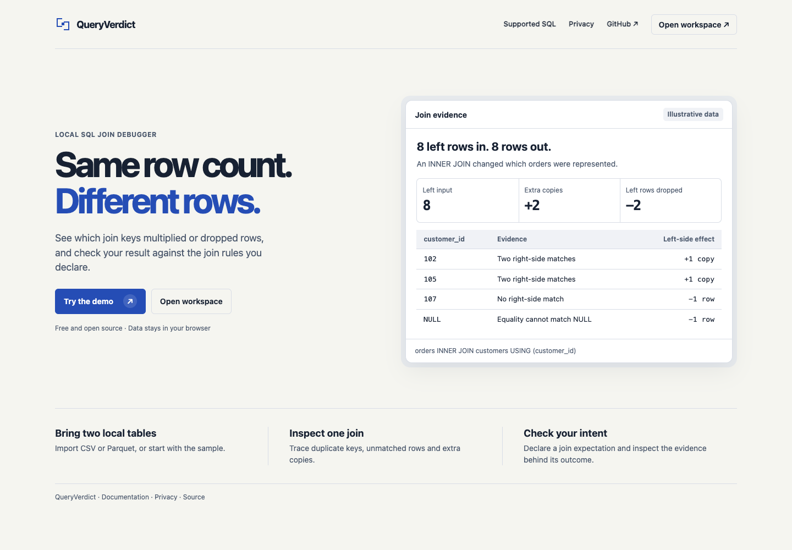
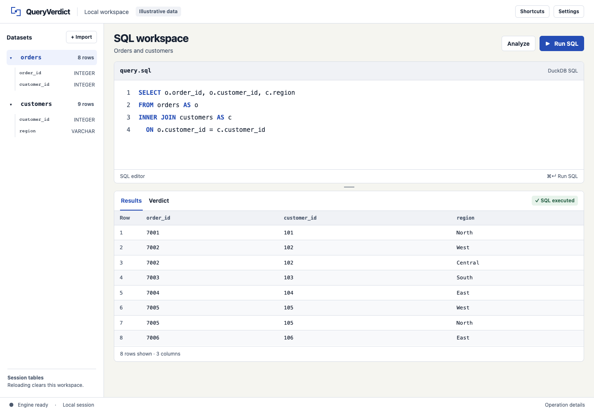
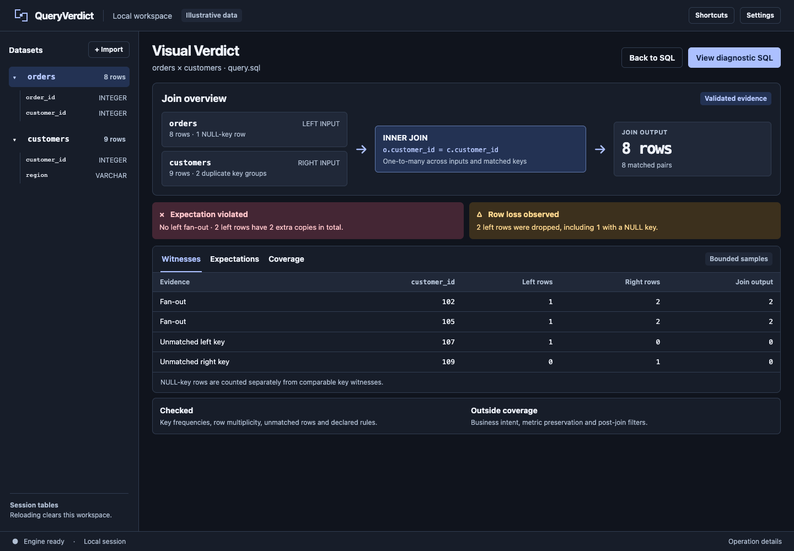

# QueryVerdict design system

**Status** · Proposed design specification, 2026-11-26. This design uses the merged [PRD](PRD.md) and the [verified feasibility handoff](SQL_ANALYSIS_FINDINGS.md#6-proposed-public-mvp-diagnostic-boundary-p-031-provisional). The repository's [architecture](ARCHITECTURE.md) is still pending. The UI contracts describe observable behavior and require architecture review before implementation. [UI implementation specification](UI_SPECIFICATION.md)

## 1. Identity

QueryVerdict should feel like a workbench for inspecting evidence. Give SQL, key values and counts the strongest visual hierarchy. Use cool ink, warm paper and a restrained cobalt accent. Reserve amber and red for evidence that needs attention. On the landing page, show a worked join example beside the value proposition. In the workspace, use aligned panels and table rules instead of cards for routine content.

The symbol is two offset square brackets meeting around a single join point. Pair it with the mixed-case QueryVerdict wordmark. Use the symbol in the favicon and alongside the name. Default to a single color with an optional accent point. Avoid a shield, checkmark or gauge in the mark. Those forms imply a security or correctness judgment.

Borrow crisp typography and restrained controls from professional tools. Use the familiar editor/sidebar/result arrangement where it helps orientation. The identity, proportions, report sequence and visual encodings are QueryVerdict's own.

## 2. High-fidelity concepts

The three static mockups show the first-release path. Their fixtures are **illustrative**. Their output does not establish engine performance, capacity, supported browsers or a released product.

| Screen | Concept |
| --- | --- |
| Landing · light | Editorial split with a worked join on the right. The unchanged row count is immediately visible, with multiplication and loss shown separately. [Landing mockup](design/landing.png) |
| SQL workspace · light | Compact dataset tree, schema hints, SQL editor and bounded results. Run SQL and Analyze are separate actions. [Workspace mockup](design/workspace.png) |
| Visual Verdict · dark | One measured join with input and output counts, declared expectations, witness rows and coverage. The layout uses a fixed reading order. [Visual Verdict mockup](design/visual-verdict.png) |

## 3. Color and theme tokens

Use semantic CSS variables with the token names below. Light, Dark and System are the only theme options. System is the first-visit default and responds to the operating system in the open tab. Prefer the system preference at first paint. Apply a manual theme override for the current session. Durable preference storage needs a privacy and architecture decision. Theme changes preserve focus, editor contents, scroll position and report state.

| Token | Light | Dark | Use |
| --- | --- | --- | --- |
| `canvas` | `#F5F5F0` | `#10141D` | Page background |
| `surface` | `#FFFFFF` | `#171D29` | Editor, panels, tables |
| `surface-raised` | `#F0F2F6` | `#202838` | Toolbar, hover, headers, selected neutral row |
| `text` | `#172132` | `#EEF2FA` | Primary text |
| `text-muted` | `#4C596D` | `#B0BED2` | Secondary text and metadata |
| `border` | `#D8DDE6` | `#313D51` | Decorative rules |
| `control-border` | `#77869B` | `#77869B` | Input boundaries and splitter affordance |
| `action` | `#254DB5` | `#ACC0FF` | Primary fill, links and selection outline |
| `on-action` | `#FFFFFF` | `#142242` | Label on primary fill |
| `focus` | `#224DBC` | `#B5C8FF` | Focus ring with a 2 px offset |
| `info-bg` / `info-text` | `#EEF2FD` / `#2449A8` | `#233253` / `#B7C9FF` | Measurement, selected evidence |
| `warning-bg` / `warning-text` | `#FBF0D9` / `#714600` | `#3C301D` / `#FFD88F` | Suspicious pattern |
| `violation-bg` / `violation-text` | `#FBEAEA` / `#932B38` | `#442634` / `#FFC5CA` | Expectation violation |
| `neutral-bg` / `neutral-text` | `#EDF0F4` / `#435169` | `#273142` / `#CBD6E7` | Unsupported, inconclusive, unchecked, stale |
| `success-bg` / `success-text` | `#E7F3EB` / `#245D42` | `#20382F` / `#A9E2BE` | Operational success, held expectation |
| `sql-keyword` | `#294AB2` | `#ACC0FF` | SELECT, JOIN, ON |
| `sql-string` | `#26604A` | `#A9E2BE` | SQL strings |
| `sql-literal` | `#885100` | `#FFD88F` | SQL literals |
| `sql-comment` | `#526177` | `#A4B2C7` | SQL comments |

Use contrast of at least 4.5:1 for standard text and 3:1 for large text and required control/focus boundaries against adjacent colors. Validate resolved text, backgrounds, hover, selection and focus together. Decorative rules can be lower contrast. Use shape or icon plus a real text label for each status. In forced colors, keep the browser focus and selection palette, and preserve status text and outlines. [WCAG 2.2](https://www.w3.org/TR/WCAG22/)

## 4. Typography, spacing and layout

- **UI** · Geist or a local system sans. **SQL and tabular values** · IBM Plex Mono or a local system monospace. Candidate fonts must be cleared and self-hosted before release. Ship the system fallback if a licensed font does not meet the asset budget. No runtime font service.
- **Scale** · Landing title 64/66 px desktop and 36/40 px narrow. H1 in workspace 24/30, H2 18/24, UI copy 14/20, dense labels 13/18, metadata 12/16. SQL starts at 14/22 and respects browser zoom. Use semibold for heading and active-action hierarchy. Use monospace or tabular numerals for counts.
- **Spacing** · 4, 8, 12, 16, 20, 24, 32, 48, 64, 80 px. Workspace panel inset 16 px, grid cell inset 12 px. Landing content max width 1240 px with 32 px gutters on desktop and 16 px on narrow screens.
- **Geometry** · 1 px decorative rule, 6 px control radius, 10 px dialog radius and 14 px illustrative panel radius. Editor and result panels use aligned edges. Shadows are reserved for overlays and the landing's illustrative frame.
- **Density** · 32 px grid rows by default, 28 px compact and 40 px comfortable where useful. Toolbar controls are 32–36 px high. Keep targets at least 24×24 CSS px wherever feasible without relying on exceptions. Use at least 44×44 px for touch-first primary navigation. Resizer hit targets can exceed the visible rule. Provide a keyboard and single-pointer preset.
- **Motion** · Avoid animated layout transitions. Use up to 120 ms for an optional color or opacity transition, with no essential information conveyed by animation. Honor reduced motion. Progress can be indeterminate text with a static marker.

## 5. Components and interaction

| Component | Variants and behavior |
| --- | --- |
| Button | Primary, secondary, quiet and destructive. Show focus ring on keyboard focus. An active operation has an explicit label such as **Analyzing…** and a separate **Cancel** action. Explain unavailable actions in visible text. |
| Input and file picker | Persistent label, helper, value and inline error. Use valid native file input as the keyboard path, with drag and drop as an enhancement. Never auto-submit a selection. |
| Tab list | Results, Verdict and context-specific detail tabs. Arrow keys navigate the tab bar. Activate manually if opening involves work. Tabs never trigger a SQL run or diagnostic. |
| Table | Row/column headers, labelled numeric units, sticky headings for long bounded lists, right-aligned counts. `NULL` is a labelled token. Empty strings have a separate representation. Truncated text has a visible indicator and an accessible explanation. |
| Tree or nested list | Dataset name, source kind, session state, child schema details and inline actions. Prefer accessible disclosure groups with a normal Tab path for the initial scope. |
| Resizable split | 1 px visible rule, 24 px hit area, clear active divider and constrained pane bounds. Provide keyboard resizing and a reset/preset menu. Use splitter semantics when supported and test them. [WAI-ARIA window splitter](https://www.w3.org/WAI/ARIA/apg/patterns/windowsplitter/) |
| Banner and status | Icon, plain-language label, concise reason and relevant next action. Keep long-running state and Cancel visible. Announce meaningful changes once via a persistent status region. Use a blocking alert only when immediate user action is necessary. |
| Dialog or sheet | Accessible name, initial focus, focus containment and restoration. Destructive or replacing actions require explicit confirmation. Use the import dialog inside the workspace and a sheet for settings on narrow layouts. |
| Badge | Text plus semantic color and glyph where helpful. Use labels such as **SQL executed**, **Warning**, **Expectation violated**, **Inconclusive**, **Unsupported** and **Historical**. No standalone colored dots for outcomes. |

### Semantics and example microcopy

| State | Treatment | Example |
| --- | --- | --- |
| SQL completed | Green operational status in Results | **SQL executed** · 8 rows shown. |
| Suspicious pattern | Amber warning with counted evidence | **Row loss observed** · 2 left rows had no match in this INNER join. Review whether both rows should be kept. |
| Expectation violation | Red rule card only with complete, validated evidence | **Expectation violated** · 2 left rows appeared more than once. Expected no left fan-out. |
| Confirmed issue | Reserved error category for a separate established correctness requirement | No independent grain or business requirement is inferred in P0. |
| Inconclusive | Neutral status with checked scope and reason | **Analysis incomplete** · Witness verification exceeded the work budget. |
| Unsupported | Neutral status plus construct and next action | **Verdict unavailable for this query** · Post-join WHERE is outside the supported scope. Run SQL remains available when the engine policy allows it. |
| Historical or cancelled | Neutral tag, alert strip and explicit next action | **Historical report** · Inputs changed. Analyze the current query to refresh the evidence. |
| Healthy supported analysis | Neutral checked-coverage summary | **No issues found in these checks.** See coverage. |

Coverage, operational state and finding severity are independent. Never pair a successful SQL status with a generic pass mark for correctness. Use text and exact measurements with units. Omit unverified resource values and fabricated scores.
