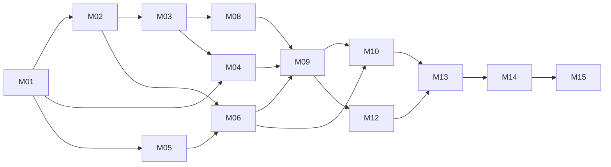

# QueryVerdict implementation plan

> **Status · Proposed, 2026-11-27.** Drafted by Claude Code at the maintainer's request (AM-017). It becomes executable only after (1) the maintainer approves this plan, [ARCHITECTURE.md](ARCHITECTURE.md) and [TESTING_STRATEGY.md](TESTING_STRATEGY.md), (2) the PRD's approval is recorded (AM-001), and (3) PROGRESS.md records the move from planning to implementation (CLAUDE.md "Current phase: planning"). Until then no production code is written.
>
> Every module is implemented on its own branch, verified by the implementer, independently reviewed by Codex, passes required CI, and is merged by the maintainer (P-011). Each module ends with a PROGRESS.md entry and DECISIONS.md updates (AGENTS.md §14).

## 1. Evaluation of the proposed module list

| Proposed | Decision | Reason |
|---|---|---|
| M01 Application Foundation | **Keep (P0).** Also owns quality gates, CI, build/artifact checks, tokens, app shell | Every later module depends on them; privacy (no-telemetry, CSP, artifact checks) starts here |
| M02 Database Engine | **Keep, broadened (P0):** engine **and session** (lockdown, queue, revocable lease, cancellation, recovery, generation, data epoch, statement classification, engine-semantics suite), plus a gated walking-skeleton deploy | Cancellation, recovery and fail-closed privacy cannot wait for M10 (QV-ENG-003/004/008/013/014). The walking skeleton de-risks Firefox/Safari early |
| M03 File Ingestion | **Keep, broadened (P0):** importer **and** catalog-reconciled dataset registry | The registry is a dependency of the explorer, Verdict eligibility and recovery (QV-ENG-011/012) |
| M04 Dataset Explorer | **Keep (P0)**, absorbs the P0 part of M07 (schema, row count, bounded preview) | PRD/UI spec limit P0 profiling to these |
| M05 SQL Workspace | **Keep (P0)**, includes editor qualification E9 and the resizable layout | Editor choice is unqualified (AM-013) |
| M06 Query Execution and Results | **Keep (P0)**, includes bounded results, statement policy and the rendering measurement | QV-ENG-006/009/010/013; virtualization decided by measurement (AM-014) |
| M07 Data Profiling | **Split:** P0 slice → M04 (schema/preview) and M09 (validated join-key profile). **Standalone profiling deferred (P2)** | PRD §7 and UI spec §3 exclude standalone profiling from P0 |
| M08 Verdict Analysis Engine | **Keep (P0), scheduled early** (right after M03) as a headless core | Hardest engineering, defect-critical (QV-SA-001/002), testable without UI; fits the Claude Max window |
| M09 Visual SQL Debugger | **Re-scoped (P0): Verdict report and Visual Verdict UI**, including expectation authoring (from M11) and the join-key profile (from M07). Graph canvas / multi-stage tracing deferred (P2) | UI spec §5; React Flow not needed (AM-012) |
| M10 Resource Management and Recovery | **Re-scoped (P0): operation status, cancellation and recovery UX, and the release-profile surface.** Engine safeguards themselves live in M02/M03/M06/M08 | The brief forbids postponing safeguards; M10 consolidates the user-facing state matrix (PRD §5) and cross-module fault e2e |
| M11 Business Expectation Validation | **Split:** the four P0 join-stage expectations → M08 (evaluation) + M09 (authoring). **Metric/grain/business rules deferred (P2)** | P-031, QV-SA-004 (metric precision), QV-ROAD-003/004 |
| M12 Export and Local Persistence | **Reduced (P0): evidence copy and replay bundle.** Durable persistence and file export deferred (P1/P2) | PRD QV-UI-003, QV-SEC-003, QV-ROAD-005; AM-019 |
| M13 Landing Page and Demonstration Datasets | **Keep (P0)** | QV-UI-002, QV-PLAT-001 |
| M14 UI/UX Refinement and Accessibility | **Keep (P0) as an audit and refinement pass.** Accessibility is built into every UI module; M14 does the cross-cutting audit and manual AT checks | QV-ACC-001 |
| M15 Production Readiness | **Keep (release qualification)** | Browser matrix, Pages deploy, notices, licence, release profile, docs |

## 2. Ordered module list and dependencies



| Order | Module | Priority | Hard dependencies | Class |
|---|---|---|---|---|
| 1 | M01 Application Foundation | P0 | – | Mandatory MVP |
| 2 | M02 Database Engine and Session | P0 | M01 | Mandatory MVP |
| 3 | M03 File Ingestion and Dataset Registry | P0 | M02 | Mandatory MVP |
| 4 | M08 Verdict Analysis Engine (headless) | P0 | M02 (M03 for registry integration tests) | Mandatory MVP |
| 5 | M04 Dataset Explorer and Inspector | P0 | M01, M03 | Mandatory MVP |
| 6 | M05 SQL Workspace and Editor | P0 | M01 | Mandatory MVP |
| 7 | M06 Query Execution and Results | P0 | M02, M05 | Mandatory MVP |
| 8 | M09 Verdict Report and Visual Verdict | P0 | M04, M06, M08 | Mandatory MVP |
| 9 | M10 Operation Status, Recovery UX and Release Profile | P0 | M06, M09 | Mandatory MVP |
| 10 | M12 Evidence Copy and Replay Bundle | P0 | M09 | Mandatory MVP |
| 11 | M13 Landing Page and Demo | P0 | M10, M12 | Mandatory MVP |
| 12 | M14 Accessibility and UI Refinement | P0 | M13 | Mandatory MVP |
| 13 | M15 Production Readiness and Release Qualification | Release | M14 | Public release qualification |

**Optional enhancements (P1, after launch):** syntax suggestions/autocomplete (QV-ROAD-001); results file export (CSV) via `<a download>`; file-backed views for ordinary SQL and JSON/NDJSON (QV-ROAD-002); durable session-only preferences.

**Post-MVP (P2):** standalone profiling (M07 remainder); metric preservation and grain expectations (M11 remainder, requires QV-SA-004); RIGHT/FULL, chains, CTEs, WHERE attribution (QV-ROAD-003); persistence (QV-ROAD-005); graph-based visual debugging.

**Scheduling with Claude Max (until 2026-12-04):** recommended order M01 → M02 → M03 → M08, the hardest engineering, without compressing review. If time runs short, finish M02 and M08 to their acceptance criteria rather than starting more modules; quality and correctness come first (CLAUDE.md).

## 3. Global conventions for every module

- **Read first:** AGENTS.md, CLAUDE.md, PROGRESS.md, DECISIONS.md, this plan's module section, ARCHITECTURE.md sections listed in the module, TESTING_STRATEGY.md sections listed.
- **Branch:** the suggested branch; one module per branch; Conventional Commits; no commit/push/merge without explicit maintainer instruction.
- **Code rules:** TypeScript strict; no `any` without a justified comment; `src/core` has no React imports; no `dangerouslySetInnerHTML`; every new runtime dependency justified in DECISIONS (AGENTS.md §10).
- **Tests:** unit + browser tests per the module; mutation check for each safety layer the module adds; report real results only.
- **Docs:** PROGRESS.md entry; DECISIONS.md for new/changed decisions; no silent spec changes (use SPEC_AMENDMENTS.md).
- **Common definition of done:** acceptance criteria met and demonstrated; typecheck, lint, unit, browser and build checks green locally; `check-artifact` clean; no new external requests; accessibility checks for new UI; PROGRESS/DECISIONS updated; completion report (files, commands, results, limitations, risks, next step, suggested commit message).
- **ReleaseProfile defaults** (`src/core/profile/profile.ts`, provisional, approved with P-036/P-020): result bounds 1,000 rows / 200 columns / 500 chars per cell / 2,000,000 display chars / 16 MiB Arrow bytes; `memory_limit` set per browser after measurement (initial development value 2 GB on the reference machine); queue wait 30 s; Verdict deadline 30 s; import deadline 120 s; cancel grace 2 s + 2 s; cleanup 5 s; boot 30 s; recovery 45 s; Verdict execution budget 50,000,000 pair rows; max input rows 50,000,000; grouping estimate 512 MiB; max key columns 8; per-file import cap and combined cap set by M15 qualification (initial development cap 50 MB combined, P-041).

---

## M01 — Application Foundation

1. **Identifier and name:** M01 Application Foundation.
2. **Objective:** A production-grade, empty application skeleton at the repository root with every quality gate, the build and artifact checks, the design tokens and an accessible app shell, so later modules add features without revisiting infrastructure.
3. **PRD requirements:** QV-PLAT-001 (static build under the project subpath), QV-SEC-001 (no external requests, no telemetry), QV-SEC-002 (harness separation), QV-SEC-003 (no durable storage), QV-ACC-001 (landmarks, skip link, focus, themes), QV-REL-001/002/003 (CI, reproducible build, notice scaffold), QV-UI-001 (themes).
4. **Priority:** P0.
5. **Dependencies:** none (requires plan approval and AM-001).
6. **Scope:**
   - root `package.json` (npm), lockfile, exact pins; scripts `dev`, `build`, `build:harness`, `preview`, `typecheck`, `lint`, `test`, `test:e2e`, `check:artifact`, `notices`;
   - TypeScript strict config (`strict`, `noUncheckedIndexedAccess`, `noImplicitOverride`, `noFallthroughCasesInSwitch`, `verbatimModuleSyntax`), excluding `spikes/`;
   - Vite config with `base: '/queryverdict/'`, production meta CSP plugin (policy from ARCHITECTURE §19, spike-proven), harness config producing `dist-harness/`;
   - ESLint (flat config) with `typescript-eslint`, React hooks rules, `no-restricted-imports` boundaries (`src/core/**` may not import React, `src/ui`, `src/features`, `src/stores`), `no-restricted-syntax` banning `dangerouslySetInnerHTML`;
   - Vitest and Playwright configs (Chromium, Firefox, WebKit projects; production server on 4173, harness on 4174);
   - `scripts/check-artifact.mjs` (fails on harness markers, test hooks, `http(s)://` origins in shipped JS other than an allowlist of documentation links in HTML, missing CSP meta; writes an asset size inventory);
   - `scripts/notices.mjs` scaffold (inventories `node_modules` runtime dependency licences into `build/notices.json`; fails on unknown licence);
   - `src/core/profile/` (`ReleaseProfile` type, defaults, validation that every bound is a finite positive number);
   - `src/core/util/errors.ts` (typed error base classes used by later modules);
   - `src/styles/tokens.css` (all DESIGN_SYSTEM §3 tokens for light and dark, spacing, type scale, radii, focus ring) and `base.css`;
   - `src/stores/uiPrefsStore.ts` (theme System/Light/Dark, session-only, `prefers-color-scheme` listener; density fixed to Standard in P0);
   - app shell: `src/main.tsx`, `src/app/App.tsx` with header (wordmark text, Settings button opening a theme dialog), skip link to main, `<main>` placeholder "Workspace (coming in later modules)", status region (`role="status"`, polite) showing "Engine not started", error boundary;
   - `harness/index.html` + `harness/main.ts` skeleton exposing nothing but a marker (`data-qv-harness`);
   - `.github/workflows/ci.yml` with `verify`, `build`, `browser` jobs (TESTING_STRATEGY §8); no deploy workflow;
   - `.gitignore` additions: `/dist-harness/`, `/public/duckdb-ext/`, `/build/`, `/playwright-report/`, `/test-results/`;
   - `README.md` "Development" section (commands) only, **after confirming with the maintainer** that the pre-existing uncommitted README change has been committed or discarded (AGENTS.md §2).
7. **Out of scope:** DuckDB or any engine code; datasets; editor; results; Verdict; landing page content; fonts (system font stack only); deploy workflow; LICENSE file unless the maintainer has chosen a licence; persistence of any kind.
8. **Files:** `package.json`, `package-lock.json`, `tsconfig.json`, `tsconfig.node.json`, `vite.config.ts`, `vite.harness.config.ts`, `vitest.config.ts`, `playwright.config.ts`, `eslint.config.js`, `index.html`, `harness/index.html`, `harness/main.ts`, `scripts/check-artifact.mjs`, `scripts/notices.mjs`, `src/main.tsx`, `src/app/App.tsx`, `src/app/ErrorBoundary.tsx`, `src/app/SettingsDialog.tsx`, `src/core/profile/profile.ts`, `src/core/util/errors.ts`, `src/stores/createStore.ts`, `src/stores/uiPrefsStore.ts`, `src/ui/Button.tsx`, `src/ui/Dialog.tsx`, `src/ui/StatusRegion.tsx`, `src/styles/tokens.css`, `src/styles/base.css`, `tests/unit/profile.test.ts`, `tests/unit/uiPrefsStore.test.ts`, `tests/unit/check-artifact.test.ts`, `tests/e2e/shell.spec.ts`, `tests/e2e/privacy.spec.ts`, `tests/e2e/helpers.ts`, `.github/workflows/ci.yml`, `.gitignore`.
9. **Dependencies (exact pins, justify each in DECISIONS):** runtime `react@19.3.1`, `react-dom@19.3.1`; dev `typescript@7.0.2`, `vite@8.3.8`, `@vitejs/plugin-react@6.3.0`, `vitest@5.1.1`, `@playwright/test@1.65.1`, `@types/react@19.3.2`, `@types/react-dom@19.3.0`, `eslint`, `typescript-eslint`, `eslint-plugin-react-hooks`, `@axe-core/playwright` (current stable versions, pinned exactly and recorded). Versions marked spike-proven are from the spike's `package.json`; if any is unavailable or incompatible, stop and report.
10. **Contracts:**
    ```ts
    // src/core/profile/profile.ts
    export interface ReleaseProfile {
      readonly results: { maxRows: number; maxColumns: number; maxCellChars: number; maxDisplayChars: number; maxArrowBytes: number };
      readonly bounds: { queueWaitMs: number; verdictMs: number; importMs: number; cancelRequestMs: number; cancelSettleMs: number; cleanupMs: number; bootMs: number; recoveryMs: number };
      readonly verdict: { executionPairRows: bigint; maxInputRows: bigint; groupingBytes: bigint; maxKeyColumns: number };
      readonly imports: { maxFileBytes: number; maxCombinedBytes: number; formats: readonly ('csv' | 'parquet')[] };
      readonly engine: { memoryLimit: string; threads: 1 };
    }
    export const DEFAULT_PROFILE: ReleaseProfile; // values from §3
    export function validateProfile(p: ReleaseProfile): string[]; // [] when valid
    // src/stores/createStore.ts
    export interface Store<T> { getSnapshot(): T; subscribe(listener: () => void): () => void }
    export function createStore<T>(initial: T): Store<T> & { set(next: T): void };
    // src/stores/uiPrefsStore.ts
    export type ThemeChoice = 'system' | 'light' | 'dark';
    export interface UiPrefs { theme: ThemeChoice; resolvedTheme: 'light' | 'dark' }
    ```
11. **UI:** header, skip link ("Skip to workspace"), main landmark, status region, Settings dialog (theme radio group; initial focus on the selected option; Escape closes; focus returns to Settings). Theme applied via `data-theme` on `<html>`; System follows `prefers-color-scheme` live. Visible focus ring per tokens. Works at 200 % zoom and 320 px width.
12. **Errors/edge cases:** `prefers-color-scheme` unsupported → light; error boundary renders a recoverable message; invalid profile fails at startup with a visible error (developer misconfiguration).
13. **Security/privacy:** meta CSP in `dist/`; no network requests besides same-origin assets; no `localStorage`/`sessionStorage`/IndexedDB/cookies written; no third-party fonts or scripts; harness markers absent from `dist/`.
14. **Resources:** none beyond the shell; bundle size recorded by `check-artifact` (baseline).
15. **Automated tests:** unit: profile defaults valid and `validateProfile` rejects zero/negative/NaN/Infinity; store notifies subscribers; theme resolution; `check-artifact` fails on a planted harness marker, a planted external URL and a missing CSP (fixture directories). E2E (Chromium, Firefox, WebKit): app loads under `/queryverdict/`; landmarks and skip link work by keyboard; theme switch preserves focus and applies tokens; axe: zero violations in both themes; network capture: only same-origin GETs; storage empty after interaction; `dist/` contains CSP meta and no harness marker.
16. **Manual verification:** `npm ci && npm run build && npm run preview`; open in Chrome, Firefox, Safari; tab through the shell; toggle themes; check DevTools Network shows only same-origin requests; zoom to 200 %.
17. **Acceptance criteria:** (a) all scripts run from a clean clone with `npm ci`; (b) typecheck, lint, unit, e2e (3 browsers) pass; (c) axe reports 0 violations on the shell in both themes; (d) `check-artifact` passes on `dist/` and fails on each planted violation; (e) zero non-same-origin requests in the capture; (f) zero storage writes; (g) the CI workflow file is syntactically valid and its jobs run the same commands verified locally; its first remote run happens only when the maintainer pushes the branch, and its result is then recorded; (h) `spikes/` untouched and excluded.
18. **Definition of done:** common DoD (§3) plus DECISIONS entries for every dependency and the ESLint/axe versions.
19. **Branch:** `feat/application-foundation` (exists locally at `main`; verify it has no commits before use).
20. **Commits:** `chore(foundation): add toolchain, strict TypeScript and lint boundaries` · `build(foundation): add Vite production and harness builds with meta CSP` · `test(foundation): add Vitest, Playwright and artifact checks` · `feat(ui): add design tokens, themes and accessible app shell` · `ci: add verify, build and browser workflows` · `docs: record foundation decisions and progress`.
21. **Codex review focus:** CSP content and placement; artifact checker can't be bypassed (markers, URLs); import boundaries enforced; no storage/network; accessibility of shell and dialog; exact pins and lockfile; spike excluded from build and type-check.
22. **Next module:** M02.

### M01 task brief (Claude Code)

> **Task:** Implement module M01 Application Foundation for QueryVerdict exactly as specified in `docs/IMPLEMENTATION_PLAN.md` § M01 (fields 1–22). You are the primary implementation engineer.
>
> **Before you start:** read `AGENTS.md`, `CLAUDE.md`, `docs/PROGRESS.md`, `docs/DECISIONS.md`, `docs/ARCHITECTURE.md` §1, §3, §4, §5, §6, §19, §20, §22, `docs/TESTING_STRATEGY.md` §1, §2, §5.9, §5.10, §5.11, §8, `docs/DESIGN_SYSTEM.md` §3–§5 and `docs/UI_SPECIFICATION.md` §7. Confirm in PROGRESS.md that the maintainer approved the move to implementation; if not, stop and ask. Check `git status`: if there are uncommitted changes you did not make (for example `README.md`), stop and ask before touching them. Work on branch `feat/application-foundation`; confirm it has no commits beyond `main`.
>
> **Build exactly:** the scope in field 6, the files in field 8, the dependencies in field 9 (exact pins; record purpose, alternatives, licence and size for each in DECISIONS.md as new provisional entries), and the contracts in field 10. The production app lives at the repository root; `spikes/` must stay untouched and be excluded from TypeScript, ESLint, Vitest, Playwright and Vite.
>
> **Key implementation details:**
> - Vite `base` is `/queryverdict/`. The meta CSP (production build only) is `default-src 'self'; script-src 'self' 'wasm-unsafe-eval'; worker-src 'self'; connect-src 'self'; img-src 'self' data: blob:; style-src 'self' 'unsafe-inline'; object-src 'none'; base-uri 'self'; form-action 'none'` (spike-proven; `wasm-unsafe-eval` is needed by M02).
> - The harness build uses `harness/index.html` as its entry, outputs `dist-harness/`, and sets `data-qv-harness="true"` on `<body>`. `check-artifact.mjs` must fail if `qv-harness`, `__qvHarness` or `testHooks` appears anywhere in `dist/`.
> - Themes: `data-theme="light|dark"` on `<html>`, CSS variables from DESIGN_SYSTEM §3 exactly (both themes), System default resolved from `matchMedia('(prefers-color-scheme: dark)')` with a change listener. Preference is session-only: never write browser storage.
> - The status region is a single persistent `role="status"` element; announcements are made by updating its text once per change.
> - Create the engine-free shell only. The status region reads "Engine not started" (M02 will drive it).
> - CI: GitHub Actions on `ubuntu-latest`, Node LTS pinned in `.nvmrc` and `engines`; jobs as in TESTING_STRATEGY §8. Install Playwright browsers in CI with `npx playwright install --with-deps chromium firefox webkit`. Locally, do **not** install browsers without maintainer approval: if they are missing, run the Chromium project with the installed Chrome channel (as the spike did) and report which browsers were not run.
>
> **Tests to write and run:** field 15 in full. Report exact commands and actual results; never claim a browser run that did not happen.
>
> **Acceptance:** field 17 (a)–(h). **Definition of done:** field 18.
>
> **Do not:** add DuckDB, an editor, routing or state libraries, fonts, analytics, a deploy workflow, a LICENSE (unless the maintainer has chosen one), or any feature from later modules. Do not commit, push or merge.
>
> **Finish with** a completion report: files created/modified; commands run with actual results; limitations (for example browsers not run locally); risks; the suggested commits from field 20; recommended next module (M02). Update PROGRESS.md and DECISIONS.md.

---

## M02 — Database Engine and Session

1. **Name:** M02 Database Engine and Session.
2. **Objective:** A fail-closed, verified DuckDB-WASM engine behind `EngineSession` with a cancellable FIFO queue, session-owned revocable leases, bounded cancellation and recovery, generation and data-epoch tracking, statement classification, and the engine-semantics qualification suite.
3. **PRD:** QV-SEC-001, QV-SEC-002, QV-RES-003, QV-SQL-001 (policy), QV-VER-004/005 (foundations), QV-REL-001 (engine semantics suite). Engineering: QV-ENG-003, 004, 008, 010 (epoch), 013, 014.
4. **Priority:** P0.
5. **Dependencies:** M01.
6. **Scope:** `scripts/vendor-extensions.mjs` + `extensions.lock.json` (ported, re-reviewed; build-time download and SHA-256 verification of `parquet` and `json` for `wasm_eh` and `wasm_mvp`); `core/engine/bundles.ts` (same-origin bundle URLs); `core/engine/lockdown.ts` (statements, required settings, verification, escalation probes; port from spike with tests); `core/engine/session.ts` implementing ARCHITECTURE §8–§9 (states, queue with queued cancel, lease revocation independent of body settlement, outer bound, cooperative cancel then terminate, bounded boot and recovery, no reattachment, dispose settles all handles, generation, epoch, single-settlement handles, late-result rejection, visibility reconciliation); `core/engine/statements.ts` (classification via `json_serialize_sql` on the leased connection; multi-statement detection experiment ES-12 with `prepare`; transaction-control hint); `core/operations/` (ids, stamps); `stores/engineStore.ts`, `stores/operationStore.ts`; harness exposure + fault injection hooks (harness only); engine-semantics suite ES-01…ES-12; status region wired to engine state. **Walking skeleton (conditional):** only if the maintainer has approved the licence and notices gate (AM-022), add `deploy.yml` (manual dispatch) and run the deployed smoke test in Chrome, Firefox and Safari; otherwise record it as pending.
7. **Out of scope:** imports, datasets, editor, results UI, Verdict; any reattachment logic; persistence.
8. **Files:** `scripts/vendor-extensions.mjs`, `scripts/extensions.lock.json`, `src/core/engine/{types.ts,bundles.ts,lockdown.ts,session.ts,lease.ts,queue.ts,statements.ts,errors.ts}`, `src/core/operations/{ids.ts,stamp.ts}`, `src/stores/{engineStore.ts,operationStore.ts}`, `src/app/bootstrap.ts`, `harness/engine.ts`, `tests/unit/engine/*.test.ts` (stand-in engine), `tests/e2e/engine-lifecycle.spec.ts`, `tests/e2e/engine-semantics.spec.ts`, `tests/e2e/lockdown.spec.ts`, `tests/e2e/network.spec.ts`, optional `.github/workflows/deploy.yml`.
9. **Dependencies:** `@duckdb/duckdb-wasm@1.33.1-dev57.0` (P-016, provisional); `apache-arrow` as resolved by it. Justify in DECISIONS.
10. **Contracts:** ARCHITECTURE §8 (`EngineSession`, `OperationHandle`, `Lease`, `Terminal`, `OperationBounds`), plus:
    ```ts
    export interface StatementClass { readonly kind: 'select' | 'possibly-mutating' | 'multiple' | 'unparseable'; readonly transactionHint: 'begin' | 'end' | null }
    export function classifyStatement(lease: Lease, sql: string): Promise<StatementClass>;
    export interface BootInfo { generation: Generation; bundle: 'eh' | 'mvp'; duckdb: string; package: string; verified: true; bootMs: number }
    ```
11. **UI:** status region texts for Starting, Ready, Recovering, Failed (with Retry button), Disposed; no other UI.
12. **Edge cases:** dispose during boot; boot step hangs; lockdown statement fails; verification mismatch; cancel while queued; cancel twice; cancel after settle; body throws; body never settles; cleanup hangs; recovery fails; StrictMode double mount; tab hidden during an operation.
13. **Security:** fail-closed boot and recovery (QV-ENG-008); escalation probes refused; network capture across boot, cancel and recovery; harness hooks absent from `dist/`.
14. **Resources:** `memory_limit` and `threads=1` from the profile at boot; worker terminated on every unrecoverable path; no leaked workers after dispose (asserted).
15. **Tests:** TESTING_STRATEGY §3 (engine core), §5.3 (ES-01…ES-12), §5.6, §5.7, §5.9; T-ENG-003a–c, 004a–d, 008a–d, 013a, 014; mutation checks: lease not revoked, queued cancel ignored, verification skipped.
16. **Manual:** boot in Chrome/Firefox/Safari locally (preview); observe status transitions; force a long query from the harness and cancel; observe recovery; DevTools Network.
17. **Acceptance:** (a) no SQL accepted before verified `ready` in any injected failure; (b) every handle settles within its bound in all §5.7 scenarios (time-asserted); (c) a never-settling body does not block a later operation beyond `runMs + 2 × cancelGrace` (T-ENG-004a); (d) queued cancel does no engine work; (e) recovery re-verifies lockdown and increments generation; failed recovery → `failed` with SQL refused; (f) ES-01…ES-12 pass in Chromium; Firefox/WebKit results recorded; (g) zero external requests; (h) ES-12 outcome recorded and AM-004 detection method decided.
18. **DoD:** common DoD; DECISIONS updates for P-016 evidence, statement policy, bounds.
19. **Branch:** `feat/engine-session`.
20. **Commits:** `build(engine): vendor and verify DuckDB extensions at build time` · `feat(engine): add verified fail-closed engine boot and lockdown` · `feat(engine): add session queue, revocable leases and bounded cancellation` · `feat(engine): add bounded recovery, generation and data epoch` · `feat(engine): classify statements for epoch and policy` · `test(engine): add engine-semantics qualification suite and fault injection` · `docs: record engine decisions and progress`.
21. **Codex focus:** lease revocation truly independent of body settlement; no statement through a revoked lease; single settlement; recovery bounds; verification cannot be bypassed; extension hash verification; harness isolation.
22. **Next:** M03.

**M02 task brief:** Implement M02 exactly as in this section. Read ARCHITECTURE §7–§9, §12, §19, §24 and TESTING_STRATEGY §3, §5.3, §5.6, §5.7, §5.9, §10 (QV-ENG-003/004/008/013/014), SQL_ANALYSIS_FINDINGS §5 (QV-SA-003, QV-SA-005) and the spike's `spikes/browser-feasibility/src/engine/{session.ts,lockdown.ts,bundles.ts}` **as reference only** (do not copy the session design: its lease lifetime is the defect QV-SA-005). Write the stand-in-engine unit tests first, then the real engine. Pin `@duckdb/duckdb-wasm@1.33.1-dev57.0`. Do not deploy unless DECISIONS records the AM-022 gate as approved. Report ES-12 results and the resulting multi-statement policy. Acceptance: field 17. Do not commit, push or merge.

---

## M03 — File Ingestion and Dataset Registry

1. **Name:** M03 File Ingestion and Dataset Registry.
2. **Objective:** Import CSV and Parquet into managed tables safely (admission, transaction, cancellation, no partial tables, unregistered files) and maintain an inventory derived from the catalog.
3. **PRD:** QV-DATA-001, QV-DATA-002, QV-RES-003, QV-SEC-003. Engineering: QV-ENG-011, 012, 013c (transaction refusal), 003c.
4. **Priority:** P0. 5. **Dependencies:** M02.
6. **Scope:** `core/datasets/importer.ts` (ARCHITECTURE §10.2: admission by extension and size caps; register file; `BEGIN`; streamed `CREATE TABLE … AS SELECT * FROM read_csv(… allow_quoted_nulls=false …)` / `read_parquet`; `COMMIT`; `dropFile`; rollback and unregister on every failure; per-file stages; cancellation); `core/datasets/naming.ts` (normalisation, collision with catalog and pending names, user rename validation); `core/datasets/registry.ts` (reconcile from `duckdb_tables()`/`duckdb_views()`; states of `DatasetEntry`; eligibility flags; row counts; columns via `DESCRIBE`); removal; re-import from retained `File` (bounded; "choose the file again" on read failure); epoch increments; `stores/datasetStore.ts`; probe ES-08 decides the CSV option set (record in DECISIONS; if `allow_quoted_nulls=false` does not behave as expected, stop and report: AM-002).
7. **Out of scope:** explorer UI (M04); JSON/NDJSON, Excel, file-backed views; persistence.
8. **Files:** `src/core/datasets/{types.ts,importer.ts,naming.ts,registry.ts,admission.ts}`, `src/stores/datasetStore.ts`, `harness/datasets.ts`, `tests/unit/datasets/*.test.ts`, `tests/e2e/imports.spec.ts`, `tests/e2e/registry.spec.ts`, `tests/fixtures/import/*` (small CSV/Parquet with generator script `scripts/fixtures/make_import_fixtures.py`).
9. **Dependencies:** none new (Python `pyarrow` for fixture generation only, dev tool, already used by the spike).
10. **Contracts:** `DatasetEntry` (ARCHITECTURE §10.4) plus:
    ```ts
    export interface ImportRequest { readonly file: File; readonly requestedName?: string }
    export type ImportStage = 'queued' | 'checking' | 'reading' | 'committing' | 'done' | 'failed' | 'cancelled';
    export interface ImportProgress { readonly fileName: string; readonly stage: ImportStage; readonly relation?: string; readonly reason?: string }
    export interface Importer { import(reqs: readonly ImportRequest[]): { handles: readonly OperationHandle<DatasetEntry>[]; progress: Store<readonly ImportProgress[]> } }
    export interface DatasetRegistry extends Store<readonly DatasetEntry[]> { reconcile(): Promise<void>; remove(relation: string): OperationHandle<void>; reimport(relation: string): OperationHandle<DatasetEntry> }
    ```
11. **UI:** none (M04).
12. **Edge cases:** quoted commas/escaped quotes; header-only CSV (zero rows, VARCHAR columns, spike-observed); empty file; malformed CSV; invalid Parquet; same file name twice; name collides with SQL-created table; user transaction open (refuse); cancel during read; recovery during import; file unreadable at re-import; user `DROP`/rename/`CREATE OR REPLACE` of an imported table.
13. **Security:** files registered only under `/qv-local/` during import and unregistered after (assert `read_csv('/qv-local/…')` fails afterwards); names are identifiers, quoted; no file content leaves the device.
14. **Resources:** size caps from the profile; import deadline; transaction guarantees no partial table; registered file count returns to zero.
15. **Tests:** TESTING_STRATEGY §4 (imports), §5.2; T-ENG-011a–b, 012, 013c, 003c; mutation: missing `ROLLBACK`/`dropFile` caught.
16. **Manual:** import fixtures in three browsers via the harness page; cancel a large (≤ 50 MB) generated import; observe inventory after `DROP TABLE` in harness SQL.
17. **Acceptance:** (a) fixtures import with exact rows, types, NULLs and `""` per policy; (b) every failure/cancel leaves no table and no registered file; (c) transaction-open refusal; (d) inventory reflects SQL-created, dropped, replaced tables after reconcile; (e) recovery marks imports `needs-reimport`; re-import works or asks for the file; (f) epoch increments on every import/removal.
18. **DoD:** common DoD; DECISIONS for CSV options (P-047 evidence).
19. **Branch:** `feat/file-ingestion`.
20. **Commits:** `feat(datasets): add transactional CSV and Parquet import with admission caps` · `feat(datasets): add catalog-reconciled dataset registry` · `test(datasets): add import, null-policy and registry tests` · `docs: record ingestion decisions`.
21. **Codex focus:** no partial tables on any path; file unregistration; null policy evidence; reconciliation correctness; transaction refusal.
22. **Next:** M08.

**M03 task brief:** Implement M03 exactly as in this section. Read ARCHITECTURE §10, §11.2, §12.4, §24 (V4) and TESTING_STRATEGY §4, §5.2, §10 (QV-ENG-011/012/013c/003c), SQL_ANALYSIS_FINDINGS §6.1, SPEC_AMENDMENTS AM-002/005/007/018. Run ES-08 first and stop if the null policy cannot be met. Acceptance: field 17. Do not commit, push or merge.

---

## M08 — Verdict Analysis Engine (headless)

1. **Name:** M08 Verdict Analysis Engine.
2. **Objective:** A production reimplementation of the verified join diagnostics for the P0 scope, with the single budget gate, snapshot consistency, complete expectation outcomes and the publication fence, independently of any UI.
3. **PRD:** QV-VER-001 … QV-VER-006, QV-RES-002. Engineering: QV-ENG-001, 002, 005, 006, 007, 009b, 015.
4. **Priority:** P0. 5. **Dependencies:** M02 (hard), M03 (registry integration).
6. **Scope:** `core/util/lossless-json.ts`; `core/verdict/parser-adapter.ts` (versioned; refuses on unqualified engine versions); `recognise.ts` (strict allowlist, P0 boundary, ARCHITECTURE §13); `relations.ts` (eligibility P-038); `qualify.ts` (rows, key widths, grouping estimate); `budget.ts` (single gate, ARCHITECTURE §14.1); `probes.ts` (frequency temp tables, stats, SEMI JOIN, executed count, witnesses, witness verification, fingerprints); `stats.ts` (derivation + invariants, ported with tests); `expectations.ts` (validation, evaluation, complete outcomes); `findings.ts` (category mapping P-026 → PRD labels); `report.ts` (draft + `publish` fence, ARCHITECTURE §16); `service.ts` (`VerdictService.analyze` submitting one `verdict` operation with its bounds); `stores/reportStore.ts`; oracle port (`tests/oracle/`, fixture generator, cases); harness exposure.
7. **Out of scope:** any UI; metric/grain expectations; RIGHT/FULL, chains, CTEs, WHERE probes; replay bundle (M12, but `report.ts` reserves the field).
8. **Files:** `src/core/util/lossless-json.ts`, `src/core/verdict/{types.ts,parser-adapter.ts,recognise.ts,relations.ts,qualify.ts,budget.ts,probes.ts,stats.ts,expectations.ts,findings.ts,report.ts,service.ts}`, `src/stores/reportStore.ts`, `harness/verdict.ts`, `scripts/fixtures/make_verdict_fixtures.py`, `tests/fixtures/verdict/cases.json`, `tests/fixtures/verdict/parser/*.json`, `tests/oracle/{oracle.py,test_oracle.py}`, `tests/unit/verdict/*.test.ts`, `tests/e2e/verdict-oracle.spec.ts`, `tests/e2e/verdict-adversarial.spec.ts`, `tests/e2e/verdict-snapshot.spec.ts`, `tests/e2e/verdict-budget.spec.ts`, `tests/e2e/verdict-fence.spec.ts`.
9. **Dependencies:** none new.
10. **Contracts:** ARCHITECTURE §14.1 (`BudgetGate`, `ProbeCost`), §14.3 (`VerdictReport`), §16.1 (`publish`), plus:
    ```ts
    export type Expectation =
      | { kind: 'relationship'; join: 0; expected: 'one-to-one' | 'one-to-many' | 'many-to-one' | 'many-to-many' }
      | { kind: 'no-row-loss'; join: 0; side: 'left' | 'right' }
      | { kind: 'no-fan-out'; join: 0; side: 'left' | 'right' }
      | { kind: 'row-count'; min?: number; max?: number };
    export interface ExpectationOutcome { index: number; expectation: unknown; outcome: 'held' | 'violated' | 'unchecked'; reason?: string; evidence?: Record<string, string> }
    export interface VerdictService { analyze(sql: string, expectations: readonly unknown[]): OperationHandle<VerdictReport> }
    ```
11. **UI:** none.
12. **Edge cases:** every refusal in TESTING_STRATEGY §5.4; empty sides; all-NULL keys; skew; offsetting fan-out and loss; keys beyond 2^53; composite keys with NULL components; self-join with aliases (decide and test; AM-011 note); user transaction open; interference (§5.5); cancel/restart/dispose at every hand-off (T-ENG-002); budget refusals.
13. **Security:** probes run only through the lease; no user SQL executed (bind only); diagnostic SQL built from parser output with identifiers quoted by DuckDB's serialiser.
14. **Resources:** budget gate before every probe; grouping qualified before grouping; deadline including queue wait; `ROLLBACK` bounded; temp tables gone after every path.
15. **Tests:** TESTING_STRATEGY §3 (Verdict), §5.1, §5.4, §5.5, §5.8; T-ENG-001, 002, 005, 006, 007, 009b, 015; full mutation list for Verdict layers.
16. **Manual:** run the harness oracle sweep in Chrome, Firefox, Safari; read three reports end to end for wording against PRD §4 labels.
17. **Acceptance:** (a) every oracle case matches oracle and DuckDB; (b) every refusal case `unsupported`/`inconclusive` with reason, never authoritative; (c) QV-SA-001 regression: zero pair-producing probes over budget; (d) QV-SA-002 regression: no authoritative report after any injected interruption; (e) exactly one outcome per expectation on all paths; (f) interference scenarios coherent or non-authoritative; (g) all Verdict mutation checks caught.
18. **DoD:** common DoD; SQL_ANALYSIS_FINDINGS defect statuses updated **only** with evidence (status "fixed in production, pending independent review").
19. **Branch:** `feat/verdict-engine`.
20. **Commits:** `feat(verdict): add lossless parser adapter and MVP recogniser` · `feat(verdict): add relation eligibility and resource qualification` · `feat(verdict): add single budget gate and validated join probes` · `feat(verdict): add expectations, findings and publication fence` · `test(verdict): add oracle, adversarial, snapshot, budget and fence suites` · `docs: record Verdict progress and defect evidence`.
21. **Codex focus:** QV-SA-001/002 closure evidence; cumulative budget accounting; fence timing; exactness; recogniser fails closed on unknown fields; oracle independence.
22. **Next:** M04.

**M08 task brief:** Implement M08 exactly as in this section. Read ARCHITECTURE §13–§16, §23, TESTING_STRATEGY §5.1, §5.4, §5.5, §5.8, §10, SQL_ANALYSIS_FINDINGS (all), FEASIBILITY §12–§14, and the spike's `src/analysis/*` **as reference only** (port `stats.ts`, `json.ts` and the oracle with their tests; redesign everything else). Write the budget-gate and fence unit tests first. Acceptance: field 17. Do not mark any QV-SA defect resolved; record evidence for independent review. Do not commit, push or merge.

---

## M04 — Dataset Explorer and Inspector

1. **Name:** M04 Dataset Explorer and Inspector.
2. **Objective:** The datasets sidebar, import dialog and inspector (schema, row count, bounded preview on explicit action), reflecting every registry state.
3. **PRD:** QV-DATA-001, QV-DATA-002, QV-UI-001, QV-ACC-001. Engineering: QV-ENG-011 (UI).
4. **Priority:** P0. 5. **Dependencies:** M01, M03.
6. **Scope:** sidebar tree (disclosure groups) with dataset name, origin (Imported / Created by SQL / Demo), state badges (Ready, Importing, Needs re-import, Removed by SQL, Changed, Failed: AM-007), row count when measured, columns and types; actions Preview, View schema, Copy table name (quoted identifier), Remove (confirm), Re-import/Choose file again; import dialog (native picker + drop target, per-file name review and conflicts, admission messages without capacity claims, per-file stages, Cancel import); inspector panel (schema first, bounded preview on explicit Preview, NULL vs empty string tokens); empty states (UI spec §2–§3).
7. **Out of scope:** standalone profiling, distributions, whole-table scans; join-key profile (M09).
8. **Files:** `src/features/explorer/{DatasetTree.tsx,ImportDialog.tsx,Inspector.tsx,DatasetActions.tsx}`, `src/ui/{Tree.tsx,Badge.tsx,FileInput.tsx,Table.tsx}`, `tests/e2e/explorer.spec.ts`, `tests/unit/explorer/*.test.tsx` (pure helpers).
9. **Dependencies:** none.
10. **Contracts:** consumes `datasetStore`, `Importer`, `DatasetRegistry`; `Table` component props `{ columns; rows: CellText[][]; caption; truncation }`.
11. **UI:** DESIGN_SYSTEM §5, UI_SPECIFICATION §3; keyboard path through picker, tree, actions; 248–256 px sidebar; drawer below 900 px.
12. **Edge cases:** all import states (UI spec table), long names, many columns, zero-row tables, re-import with lapsed file access, removal of a table referenced by the current query.
13. **Security:** names/cells rendered as text; preview bounded by the profile; no automatic scans on selection.
14. **Resources:** preview uses the bounded result path (M06 shared `core/results`; if M06 is not merged yet, M04 implements preview through `core/results` added here and M06 reuses it).
15. **Tests:** e2e: import flows (keyboard only), mixed outcomes, duplicate names, removal, post-restart re-import, SQL-created/dropped table states; axe on each state; unit for name validation UI helpers.
16. **Manual:** VoiceOver/NVDA pass over tree and dialog; 200 % zoom.
17. **Acceptance:** UX-002 passes; every `DatasetState` renders with text label; zero axe violations; preview never starts without explicit action.
18. **DoD:** common DoD. 19. **Branch:** `feat/dataset-explorer`.
20. **Commits:** `feat(explorer): add dataset tree with registry states` · `feat(explorer): add accessible import dialog` · `feat(explorer): add schema inspector and bounded preview` · `test(explorer): add import and state flows`.
21. **Codex focus:** state coverage vs registry; focus management; no implicit scans; text rendering of untrusted names.
22. **Next:** M05.

**M04 task brief:** Implement M04 exactly as in this section. Read UI_SPECIFICATION §2–§3, DESIGN_SYSTEM §4–§5, ARCHITECTURE §10.4, §17, SPEC_AMENDMENTS AM-007. Acceptance: field 17. Do not commit, push or merge.

---

## M05 — SQL Workspace and Editor

1. **Name:** M05 SQL Workspace and Editor.
2. **Objective:** The workspace layout (header, sidebar, editor/output stack with keyboard-resizable splitters, status strip) and a qualified SQL editor with Run SQL and Analyze actions.
3. **PRD:** QV-UI-001, QV-ACC-001, QV-SEC-001 (self-hosted editor assets).
4. **Priority:** P0. 5. **Dependencies:** M01.
6. **Scope:** **E9 editor qualification first** (CodeMirror 6 leading candidate vs Monaco: production bundle cost, self-hosting with no CDN request, Tab escape, screen-reader behaviour, token theming, forced colours; write results to FEASIBILITY §15 and DECISIONS P-052; stop for maintainer decision if neither passes); then the chosen editor with SQL highlighting, line numbers, language label "DuckDB SQL", wrap toggle; layout regions and splitters (WAI-ARIA window splitter, arrow keys, reset); Run SQL (Ctrl/Cmd+Enter) and Analyze (Ctrl/Cmd+Shift+Enter) buttons and shortcuts scoped to the editor; shortcut reference dialog; responsive behaviour (≥1200, 900–1199, <900 px).
7. **Out of scope:** executing SQL (M06), Verdict UI (M09), autocomplete (P1), persistence of SQL.
8. **Files:** `src/features/workspace/{Workspace.tsx,Layout.tsx,StatusStrip.tsx,ShortcutsDialog.tsx}`, `src/features/editor/{SqlEditor.tsx,editorTheme.ts}`, `src/ui/Splitter.tsx`, `tests/e2e/workspace.spec.ts`, `tests/e2e/editor-a11y.spec.ts`, `docs/FEASIBILITY.md` §15 (E9 record).
9. **Dependencies:** the E9 winner, exact pin, justified (bundle size measured).
10. **Contracts:** `SqlEditor` props `{ value; onChange; onRun; onAnalyze; ariaLabel; readOnly? }`; editor text lives in a `workspaceStore` (session only).
11. **UI:** UI_SPECIFICATION §4, §7; DESIGN_SYSTEM tokens mapped into the editor theme for both themes.
12. **Edge cases:** very long SQL; paste of large text; IME input; zoom; narrow widths; editor focus escape.
13. **Security:** editor assets same-origin; no CDN; network capture asserts it.
14. **Resources:** editor bundle cost recorded; lazy-load the editor chunk after shell paint if E9 shows benefit.
15. **Tests:** E9 measurements (recorded); e2e keyboard: Tab escape, splitter resize, shortcuts, dialog focus; axe; network capture.
16. **Manual:** screen reader editing in VoiceOver and NVDA; forced colours.
17. **Acceptance:** E9 decision recorded with measurements; zero external requests; editor exit by keyboard documented and tested; splitters operable by keyboard; zero axe violations.
18. **DoD:** common DoD. 19. **Branch:** `feat/sql-workspace`.
20. **Commits:** `docs(feasibility): record editor qualification E9` · `feat(workspace): add layout, splitters and status strip` · `feat(editor): add qualified SQL editor with run and analyze actions` · `test(workspace): add keyboard and accessibility tests`.
21. **Codex focus:** E9 method honesty; no CDN; keyboard traps; splitter semantics.
22. **Next:** M06.

**M05 task brief:** Implement M05 exactly as in this section. Run E9 before choosing the editor; stop and report if neither candidate meets the criteria. Read UI_SPECIFICATION §4, §7, DESIGN_SYSTEM §3–§5, ARCHITECTURE §5, §24 (V11, V12), SPEC_AMENDMENTS AM-013. Acceptance: field 17. Do not commit, push or merge.

---

## M06 — Query Execution and Results

1. **Name:** M06 Query Execution and Results.
2. **Objective:** Run user SQL through the session with bounded results, exact formatting, statement policy, epoch updates and a results grid that meets the responsiveness target.
3. **PRD:** QV-SQL-001, QV-RES-001, QV-UI-001. Engineering: QV-ENG-006 (cells), 009, 010, 013.
4. **Priority:** P0. 5. **Dependencies:** M02, M05.
6. **Scope:** `core/results/` (bounded collection + exact formatting, ported with tests); `core/query/runner.ts` (classification, multi-statement policy per M02 ES-12, run as `query` operation, epoch increment for possibly-mutating statements, stamps); results panel (SQL executed status, row/column counts, truncation reasons separately, NULL/empty tokens, clipped-cell indicator and bounded detail viewer, zero rows, affected rows when reported, "display order" label without ORDER BY); error rendering (parse/bind/execute); **rendering measurement R1** at P-020 bounds in three browsers and the virtualization decision (P-051; AM-014).
7. **Out of scope:** sorting/filtering of results (P1), export (P1), Verdict.
8. **Files:** `src/core/results/{collect.ts,format.ts,types.ts}`, `src/core/query/runner.ts`, `src/features/results/{ResultsPanel.tsx,ResultGrid.tsx,CellDetail.tsx}`, `tests/unit/results/*.test.ts`, `tests/e2e/query.spec.ts`, `tests/e2e/results-render.spec.ts`, `docs/FEASIBILITY.md` §16 (R1 record).
9. **Dependencies:** `@tanstack/react-virtual@3.x` **only if** R1 fails the target and the maintainer approves.
10. **Contracts:** `BoundedResult`, `CellText`, `ResultLimits` (ARCHITECTURE §11.1); `QueryRunner.run(sql): OperationHandle<BoundedResult>`.
11. **UI:** UI_SPECIFICATION §4 results grid rules; Cancel reachable; results tab activation rules.
12. **Edge cases:** huge cells, wide rows, nested types, binary, DECIMAL(38), HUGEINT, timestamps with time zones, zero rows, DDL/DML results, errors, multi-statement, transaction statements, cancellation mid-stream.
13. **Security:** cells as text; no HTML rendering.
14. **Resources:** bounds before conversion; one batch allocation limitation documented in UI details; R1 decides windowing.
15. **Tests:** TESTING_STRATEGY §3 (results), §4 (query execution); T-ENG-006b, 009a–c, 010b, 013a–b; R1 measurements recorded.
16. **Manual:** visible-window responsiveness at bounds in three browsers; screen reader on grid.
17. **Acceptance:** every truncation cause distinct; exact values; epoch rules; R1 recorded and grid meets "no long task > 200 ms" in Chromium (target) with Firefox/Safari traces recorded; UX-003 passes.
18. **DoD:** common DoD. 19. **Branch:** `feat/query-results`.
20. **Commits:** `feat(results): add bounded collection and exact formatting` · `feat(query): add query runner with statement policy and epoch updates` · `feat(results): add accessible results grid` · `perf(results): record rendering measurement and grid decision` · `test(results): add bounds, formatting and query tests`.
21. **Codex focus:** bounds before conversion; exactness; epoch correctness; measurement honesty.
22. **Next:** M09.

**M06 task brief:** Implement M06 exactly as in this section. Read ARCHITECTURE §11, §17, TESTING_STRATEGY §3, §4, §7, UI_SPECIFICATION §4, SPEC_AMENDMENTS AM-003/004/014. Run R1 before deciding on virtualization; do not add TanStack Virtual without the maintainer's approval of the measurement. Acceptance: field 17. Do not commit, push or merge.

---

## M09 — Verdict Report and Visual Verdict

1. **Name:** M09 Verdict Report and Visual Verdict (absorbs P0 parts of M07 and M11).
2. **Objective:** Present Verdict reports exactly as specified: identity and coverage, measured join, findings and expectations, witnesses, checked/outside scope; author the four P0 expectations; show historical state.
3. **PRD:** QV-VER-002/003/005/006, QV-UI-001, QV-UI-003 (preview), QV-ACC-001. Engineering: QV-ENG-002 (UI side), 010.
4. **Priority:** P0. 5. **Dependencies:** M04, M06, M08.
6. **Scope:** Verdict tab and full-width detail view (Back to SQL restores focus); join overview (inputs → join → output, exact counts, LEFT preserved vs dropped, whole-input vs matched-key relationship); findings (warning/violation/observation with side and stage; both sides' loss per AM-011); expectations panel (add/edit the four rule types with validation; outcomes held/violated/unchecked with reasons); witnesses (≤ 5 per kind, NULL totals separate, "No sample keys" state); coverage and authority (Current/Historical tag, non-authoritative reasons); unsupported/inconclusive/cancelled/stale states; join-key profile in the inspector from the current report only.
7. **Out of scope:** graph canvas, multi-stage tracing, metric/grain rules, copying (M12).
8. **Files:** `src/features/verdict/{VerdictPanel.tsx,JoinOverview.tsx,Findings.tsx,ExpectationsEditor.tsx,Witnesses.tsx,Coverage.tsx,VerdictStates.tsx}`, `src/features/explorer/JoinKeyProfile.tsx`, `tests/e2e/verdict-ui.spec.ts`, `tests/unit/verdict-ui/*.test.ts`.
9. **Dependencies:** none.
10. **Contracts:** consumes `reportStore` snapshots (`VerdictReport` + staleness) and `VerdictService.analyze`.
11. **UI:** UI_SPECIFICATION §5, DESIGN_SYSTEM §5 microcopy; text + icon for every status; no pass marks.
12. **Edge cases:** every report status; historical after edit/epoch/generation change; many findings; unchecked invalid expectations; zero witnesses; numbers beyond 2^53 displayed exactly.
13. **Security:** witness values and identifiers rendered as text.
14. **Resources:** report rendering bounded (≤ 15 witness rows).
15. **Tests:** golden report tests for natural fan-out, declared violation, missing evidence, unsupported, SQL error, probe failure, cancellation (PRD QV-VER-006); UX-004; axe for each state; T-ENG-010a/c.
16. **Manual:** screen-reader reading order of the join overview; both themes.
17. **Acceptance:** UX-004 passes; illustrative fixture reproduces the mockup counts; historical reports never show a current violation; zero axe violations.
18. **DoD:** common DoD. 19. **Branch:** `feat/visual-verdict`.
20. **Commits:** `feat(verdict-ui): add Verdict panel with join overview` · `feat(verdict-ui): add findings, expectations and witnesses` · `feat(verdict-ui): add coverage, authority and historical states` · `test(verdict-ui): add golden report and accessibility tests`.
21. **Codex focus:** category/label mapping vs PRD §4 and AGENTS.md §8; no implied pass; staleness display.
22. **Next:** M10.

**M09 task brief:** Implement M09 exactly as in this section. Read PRD §4, UI_SPECIFICATION §5, DESIGN_SYSTEM §5, ARCHITECTURE §14.3, §16, SPEC_AMENDMENTS AM-011. Acceptance: field 17. Do not commit, push or merge.

---

## M10 — Operation Status, Recovery UX and Release Profile

1. **Name:** M10 Operation Status, Recovery UX and Release Profile.
2. **Objective:** One consistent user-facing state model for queued/active/cancelling/recovering/failed operations across import, SQL and Verdict, and a visible, honest release-profile/limits surface.
3. **PRD:** QV-RES-003, QV-RES-004 (surface), QV-UI-001, PRD §5 state matrix. Engineering: cross-module fault e2e for QV-ENG-002/003/004/014.
4. **Priority:** P0. 5. **Dependencies:** M06, M09.
6. **Scope:** status strip operation list (Queued with reason, Running SQL, Importing, Analyzing, Cancelling, Recovering, Failed, Ready); Cancel for queued and active operations; elapsed time from the local clock only; Operation details (configured limits labelled "limit", measured counters with source, no memory percentages/ETAs); recovery explanation (lost tables, re-import, SQL-created tables to recreate); failed-engine retry; transaction-open hint; visibility reconciliation messaging; cross-module fault-injection e2e suite.
7. **Out of scope:** engine telemetry beyond `duckdb_memory()` (optional, only if qualified); background guarantees.
8. **Files:** `src/features/workspace/{OperationList.tsx,OperationDetails.tsx,RecoveryNotice.tsx}`, `tests/e2e/operations.spec.ts`, `tests/e2e/recovery-ux.spec.ts`.
9. **Dependencies:** none.
10. **Contracts:** consumes `operationStore`, `engineStore`, `ReleaseProfile`.
11. **UI:** UI_SPECIFICATION §6; announcements once via the status region.
12. **Edge cases:** cancel storms, cancel during recovery, multiple queued operations, failure during re-import.
13. **Security:** no data in operation labels beyond relation names and query identity.
14. **Resources:** the UI never polls the engine; it subscribes.
15. **Tests:** UX-005; fault-injected queued, running, timed-out and failed-recovery paths operable by keyboard; old results cannot republish.
16. **Manual:** recovery walkthrough in three browsers.
17. **Acceptance:** UX-005 passes; every PRD §5 state matrix row demonstrated by a test.
18. **DoD:** common DoD. 19. **Branch:** `feat/operations-recovery-ux`.
20. **Commits:** `feat(operations): add operation list with queued and active cancel` · `feat(operations): add recovery and failure notices` · `feat(operations): add operation details with configured limits` · `test(operations): add cross-module fault-injection flows`.
21. **Codex focus:** state matrix completeness; no fabricated telemetry; focus not moved by background updates.
22. **Next:** M12.

**M10 task brief:** Implement M10 exactly as in this section. Read PRD §5, UI_SPECIFICATION §6, ARCHITECTURE §12, TESTING_STRATEGY §5.6–§5.7. Acceptance: field 17. Do not commit, push or merge.

---

## M12 — Evidence Copy and Replay Bundle (reduced)

1. **Name:** M12 Evidence Copy and Replay Bundle.
2. **Objective:** Let users explicitly copy a neutral summary and a reproducible, version-stamped diagnostic script.
3. **PRD:** QV-UI-003, QV-SEC-001, QV-SEC-003.
4. **Priority:** P0. 5. **Dependencies:** M09.
6. **Scope:** `core/verdict/replay.ts` (ARCHITECTURE §18.2 bundle: engine versions, prerequisites, labelled statements with expected values, stable temp names, no fingerprints/catalog/transaction statements); summary builder (no SQL, identifiers or witness values by default; opt-in toggles); preview dialog showing exact content before copy; clipboard write on user action only; announcement without focus move; replay verification test running the bundle in the harness on a matching snapshot.
7. **Out of scope:** files, durable storage, sharing links, result export (P1).
8. **Files:** `src/core/verdict/replay.ts`, `src/features/verdict/{CopyDialog.tsx,summary.ts}`, `tests/unit/replay.test.ts`, `tests/e2e/copy.spec.ts`.
9. **Dependencies:** none.
10. **Contracts:** `ReplayBundle` (ARCHITECTURE §18.2); `buildSummary(report, options): string`.
11. **UI:** UI_SPECIFICATION §5 coverage and reproduction row.
12. **Edge cases:** historical/non-authoritative reports (labelled in summary); clipboard permission denied; very long SQL.
13. **Security:** no automatic copying; default summary excludes private values; nothing in URLs.
14. **Resources:** bundle size bounded by report size.
15. **Tests:** replay reproduces labelled counts; summary privacy defaults; copy only after action.
16. **Manual:** paste into a DuckDB v1.5.4 CLI (if available) and compare.
17. **Acceptance:** replay bundle reproduces each labelled count in the harness; summary contains no SQL/identifiers/witness values by default; AM-019 satisfied.
18. **DoD:** common DoD. 19. **Branch:** `feat/evidence-copy`.
20. **Commits:** `feat(verdict): add version-stamped replay bundle` · `feat(verdict-ui): add copy preview for summary and diagnostic SQL` · `test(verdict): add replay and privacy tests`.
21. **Codex focus:** replay fidelity; privacy defaults; version stamping.
22. **Next:** M13.

**M12 task brief:** Implement M12 exactly as in this section. Read PRD QV-UI-003, ARCHITECTURE §18, SPEC_AMENDMENTS AM-019. Acceptance: field 17. Do not commit, push or merge.

---

## M13 — Landing Page and Demo

1. **Name:** M13 Landing Page and Demonstration Dataset.
2. **Objective:** A landing view and a one-action synthetic demo that reproduces the illustrative fixture with known answers.
3. **PRD:** QV-UI-002, QV-PLAT-001, QV-ACC-001.
4. **Priority:** P0. 5. **Dependencies:** M10, M12.
6. **Scope:** landing (copy per UI spec §2 with AM-010 licence gate and AM-011 fixes); demo generator script and committed small fixture (orders/customers from UI_SPECIFICATION §5 fixture); Load demo (confirmation if replacing state; marks workspace "Illustrative data"); example query and example expectation; known-answer tests for visible counts and witnesses; README demo link and data terms.
7. **Out of scope:** marketing content, analytics, external images/fonts.
8. **Files:** `src/features/landing/Landing.tsx`, `src/demo/{demo.ts,orders.csv,customers.csv}`, `scripts/fixtures/make_demo.py`, `tests/e2e/demo.spec.ts`.
9. **Dependencies:** none.
10. **Contracts:** `loadDemo(): OperationHandle<void>` via the importer (demo origin).
11. **UI:** landing mockup with corrections; responsive per UI spec §7.
12. **Edge cases:** demo while datasets exist; engine not ready; recovery during demo load.
13. **Security:** demo data synthetic; no network beyond same origin.
14. **Resources:** demo tiny.
15. **Tests:** UX-001; known answers (8 output rows, 8 matched pairs, 2 excess copies, 2 left rows dropped, 1 right row dropped, 1 NULL-key row); axe; reflow.
16. **Manual:** first-use walkthrough in three browsers.
17. **Acceptance:** UX-001 passes; counts exactly match the fixture; landing claims only verified facts.
18. **DoD:** common DoD. 19. **Branch:** `feat/landing-demo`.
20. **Commits:** `feat(demo): add synthetic demo dataset with known answers` · `feat(landing): add landing page and demo entry` · `test(demo): add first-use and known-answer tests`.
21. **Codex focus:** copy honesty; demo replacement confirmation; known answers.
22. **Next:** M14.

**M13 task brief:** Implement M13 exactly as in this section. Read UI_SPECIFICATION §2, §5 (fixture), DESIGN_SYSTEM §1–§2, SPEC_AMENDMENTS AM-010/011. Acceptance: field 17. Do not commit, push or merge.

---

## M14 — Accessibility and UI Refinement

1. **Name:** M14 Accessibility and UI Refinement.
2. **Objective:** A cross-cutting audit and correction pass so every P0 workflow meets WCAG 2.2 AA on the intended release matrix.
3. **PRD:** QV-ACC-001, QV-UI-001.
4. **Priority:** P0. 5. **Dependencies:** M13.
6. **Scope:** full axe sweep of all states; keyboard-only completion of UX-001…UX-006; manual VoiceOver and NVDA checks with written results; zoom/reflow, forced colours, reduced motion; fixes; documented known issues with severity.
7. **Out of scope:** new features; density modes beyond Standard (P1 unless approved).
8. **Files:** fixes across `src/ui`, `src/features`; `docs/qualification/accessibility.md`; `tests/e2e/a11y-sweep.spec.ts`.
9. **Dependencies:** none.
10. **Contracts:** none new.
11. **UI:** as specified.
12. **Edge cases:** dynamic announcements during long operations; dialog stacking.
13. **Security:** n/a. 14. **Resources:** n/a.
15. **Tests:** TESTING_STRATEGY §5.11 in full.
16. **Manual:** the checklist in `docs/qualification/accessibility.md`.
17. **Acceptance:** zero automated violations; no open release-blocking manual issue.
18. **DoD:** common DoD. 19. **Branch:** `fix/accessibility-audit`.
20. **Commits:** `fix(a11y): …` per issue group · `docs(qualification): record accessibility audit`.
21. **Codex focus:** audit evidence vs claims.
22. **Next:** M15.

**M14 task brief:** Execute M14 exactly as in this section. Record manual results honestly, including untested assistive technologies. Acceptance: field 17. Do not commit, push or merge.

---

## M15 — Production Readiness and Release Qualification

1. **Name:** M15 Production Readiness and Release Qualification.
2. **Objective:** Qualify and document the first public release: licence, notices, deployment, browser matrix, release profile, security/privacy/contribution docs.
3. **PRD:** QV-PLAT-001, QV-REL-001…004, QV-RES-004, QV-SEC-001, QV-ACC-001.
4. **Priority:** Release. 5. **Dependencies:** M14.
6. **Scope:** licence file (maintainer's choice); complete `notices.mjs` and reviewed `THIRD_PARTY_NOTICES.md` (DuckDB-WASM MIT from upstream, DuckDB, bundled components, Arrow NOTICE, editor, React); `deploy.yml` (manual dispatch); deployed-site verification (TESTING_STRATEGY §5.13) in Chrome, Firefox, Safari; release-profile measurements (§7) at the 50 MB candidate ceiling; first-load budget (AM-015); engine pin decision (AM-020); `SECURITY.md`, `CONTRIBUTING.md`, privacy statement, issue templates, release checklist; README update.
7. **Out of scope:** new features; claims beyond measured results; 1 GB claims.
8. **Files:** `LICENSE`, `THIRD_PARTY_NOTICES.md`, `.github/workflows/deploy.yml`, `.github/ISSUE_TEMPLATE/*`, `SECURITY.md`, `CONTRIBUTING.md`, `docs/PRIVACY.md`, `docs/RELEASE_CHECKLIST.md`, `docs/qualification/*`.
9. **Dependencies:** none.
10. **Contracts:** `ReleaseProfile` values finalised from measurements.
11. **UI:** "Supported SQL" and "Privacy" pages/sections linked from the landing.
12. **Edge cases:** a browser fails qualification → narrower release requires an approved scope revision (PRD).
13. **Security:** deployed network capture; artifact inventory review.
14. **Resources:** measured peak memory recorded (method per AM-009).
15. **Tests:** release-blocking criteria (TESTING_STRATEGY §9) in full.
16. **Manual:** release checklist.
17. **Acceptance:** all TESTING_STRATEGY §9 criteria met; maintainer approval recorded.
18. **DoD:** common DoD + release notes. 19. **Branch:** `chore/release-qualification`.
20. **Commits:** `docs: add licence, notices and project policies` · `ci: add manual Pages deployment` · `docs(qualification): record release measurements` · `chore(release): finalise release profile`.
21. **Codex focus:** every published claim traceable to a recorded run; notice completeness; deployed privacy.
22. **Next:** public release decision (maintainer).

**M15 task brief:** Execute M15 exactly as in this section. Never publish a capability, browser or size claim without a recorded passing run. Do not deploy without the maintainer's explicit instruction for that deployment. Acceptance: field 17. Do not commit, push or merge.

---

## 4. Outstanding engineering blockers before implementation

1. Maintainer approval of the PRD (AM-001), this plan, ARCHITECTURE and TESTING_STRATEGY; PROGRESS records the move to implementation.
2. Decisions on SPEC_AMENDMENTS AM-002 to AM-016 (AM-002/004/005/007 shape M03/M06; AM-013/014 are resolved by measurement inside M05/M06).
3. Licence choice and notice review before any deployment (AM-022) — blocks only the M02 walking-skeleton deploy and M15.
4. Open defects QV-SA-001 … QV-SA-005 remain open until production evidence and independent review (ARCHITECTURE §23).
5. The pre-existing uncommitted `README.md` change in the working tree must be committed or discarded by the maintainer before M01 touches README.
